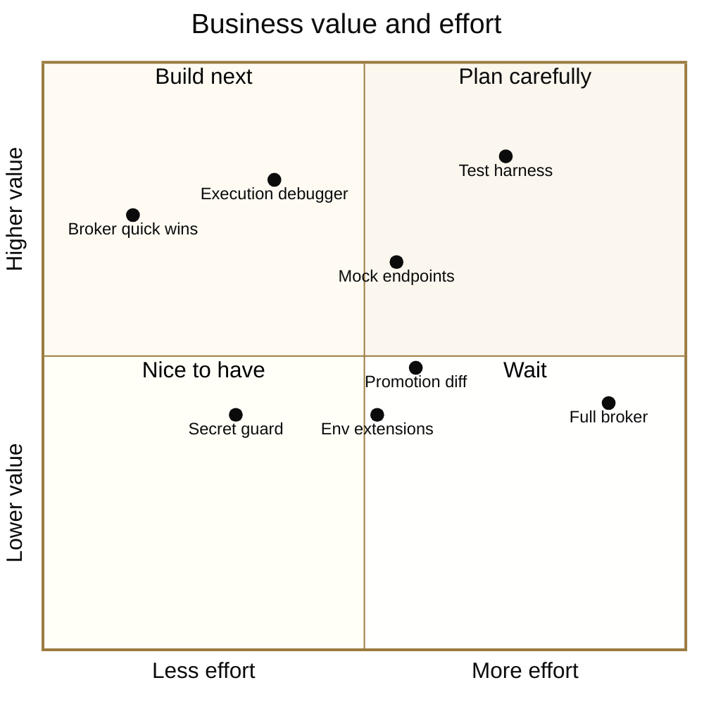

# Mod Ideas

Ideas for mods we could build next, starting with Boomi and integration work. The ideas below aren't built yet. Treat it as a brainstorm: add ideas, argue with the rankings, and claim one to build.

**Built from this page so far:**
- The Companion guardrail, built as the boomi-standards mod and then set aside; see [Boomi standards: bring it back](#boomi-standards-bring-it-back).
- The deployment watcher, folded into the [boomi-dashboard](boomi-dashboard/README.md) mod: a live summary of a Companion session that watches components for changes. (Polling the environment's runs is set aside for now; see [Dashboard follow-ups](#dashboard-follow-ups).)
- The first half of the execution debugger, in the dashboard: **Why?** reads a failed run's process log and **Ask Claude to fix** drafts the request. A session report (`/bc-dashboard report`) came with it.
- Dashboard follow-ups: **Run again** for a failed test, a spend budget (`budgetUsd`), and the next step (deploy, then test) suggested in the prompt box.
- Guardrails at a glance: the dashboard's **Guardrails** section shows the runtime's state, and what boomi-standards blocked once that mod is back.
- Companion's activity log as a second source, and a new-session banner with the last session's recap and tips.

The [boomi-runtime](boomi-runtime/README.md) mod shows what a mod can do. It provisions a temporary Boomi runtime in the session, smoke-tests it, hands it to Boomi Companion through a shared `.env` and tears everything down at the end, while keeping the Platform API token out of the conversation. Mods can add:

- slash commands
- tools Claude can call
- network, process and file access
- session state
- lifecycle hooks, including hooks before and after every tool call
- status lines and panes

## What makes a good mod idea

A mod is worth building over a skill or a script when it uses something only a mod has:

- **Work that outlasts Claude's reply.** Polling, installs and watchers keep running in the background while you keep chatting.
- **A hook on every tool call.** A mod can check, refuse or redact what Claude does before or after it happens. `boomi-runtime` uses this to guard the API token.
- **The session's own runtime.** The Boomi runtime runs in the session's container, so a mod can put files in local folders the runtime reads, read its execution logs on disk, and start local services for it to call.
- **Commands that cost no tokens.** Slash commands run the same way every time without Claude interpreting them.

One limit to design around: **the Claude Code web app doesn't show status lines or panes yet.** An idea that depends on a pane should also work through a slash command.

## Value and effort

| Rank | Idea | Business value | Effort | Status |
|---|---|---|---|---|
| Next | [Boomi standards: bring it back](#boomi-standards-bring-it-back) | High | Small | Built, set aside; to restore soon |
| Next | [The dashboard across all of Boomi Companion](#the-dashboard-across-all-of-boomi-companion) | High | Small first, medium in all | Steps 1 and 2 built (0.13.0, 0.16.0); step 3 next |
| 1 | [Execution debugger](#execution-debugger) | High | Small to medium | Log reading built into the dashboard; per-step documents next |
| 2 | [Credential broker: quick wins](#credential-broker) | High | Small | Secure-storage token tried and removed; API-user guide kept |
| 3 | [Process test harness](#process-test-harness) | High | Medium to large | Idea |
| 4 | [Mock endpoints](#mock-endpoints) | Medium to high | Medium | Idea |
| 5 | [General secret guard](#general-secret-guard) | Medium | Small to medium | Idea |
| 6 | [Promotion diff](#promotion-diff) | Medium | Medium | Idea |
| 7 | [Environment extensions manager](#environment-extensions-manager) | Medium | Medium | Idea |
| 8 | [Credential broker: full](#credential-broker) | Medium | Large | Idea |

## The ideas

### Boomi standards: bring it back

**Hold Companion's components to the team's standards before they reach Boomi. Built, then set aside; it comes back in the near future.**

- **What it was:** the boomi-standards mod (0.2.0) read each component's XML before Companion created, pushed or deployed it, and refused the call when it broke a rule: naming per component type, allowed folders, forbidden text such as production hosts, passwords typed into password fields, and a Try/Catch in every process. Teams set the rules in a checked-in `boomi-standards.json`. Its tests passed and it was run against a live Boomi account.
- **Why it's out:** set aside in October 2026 to focus on the dashboard. Nothing was wrong with it.
- **To restore:** `git checkout cd07899 -- boomi-standards`, then add it back to the **Mods** table in the [README](README.md), to `PAGES` and `COPY_PATHS` in `site/build.py`, and to the `paths` in `.github/workflows/pages.yml`. Restore the standards half of checklist item B10, and the boomi-standards links in the dashboard README (**Guardrails**, and **⚠ save blocked** in the stages table).
- **Already waiting for it:** the dashboard still reads boomi-standards' `activity` state for its **Guardrails** section, with tests, so that comes back without changes.
- **Before it returns:** run `claude plugin validate` and `claude plugin test` on it against the Claude Code of the day, and recheck it against Companion's current XML format.

### Execution debugger

**Show Claude which step of a process failed, and what data it had at that point.**

- **Problem:** When a test execution fails, Claude often sees little more than `ERROR` and has to guess.
- **Idea:** A `/boomi trace <execution>` command and a `trace` tool Claude can call. They pull the execution's process log and each step's documents from the local runtime, then summarize where the documents stopped and why.
- **Why a mod:** The runtime runs in the session's container, so the execution artifacts are on local disk. This extends the existing `logs` tool.
- **Open question:** Which execution artifacts the runtime keeps on disk by default, and for how long.
- **Built so far:** The dashboard's **Why?** button reads the process log through Companion's own script. What's left is each step's documents from a local runtime.

### Credential broker

**Let mods and skills call the Platform API without the token ever being visible in the session.**

- **Quick wins:**
  - **Tried and removed:** the token in Claude Code's secure storage, handed to Companion's scripts only while one ran. Tests and a fake-token probe passed, but in real use it broke Companion, so it came out (boomi-runtime 0.3.0). Don't retry it without a live Companion session to test against.
  - **Kept:** a dedicated API user with only the permissions the work needs, and how to rotate its token, in the [boomi-runtime README](boomi-runtime/README.md#a-dedicated-api-user).
  - Still to try: the cloud environment's network secrets, which add credentials in the proxy.
- **Full broker:** The mod holds the token and offers a `boomi_api` tool that makes allow-listed Platform API calls for other mods and skills, so none of them needs the token.
- **Limit:** Companion's scripts read the token from `.env`, and the broker can't change that. It protects everything except Companion's own calls, which is why the full version ranks lower than the quick wins.

### Process test harness

**Run sample documents through a deployed process and compare the outputs with expected results.**

- **Problem:** Integrations rarely have regression tests, so a mapping change can quietly break a field nobody checked.
- **Idea:** A `tests/` folder of input documents and expected outputs per process. `/boomi test <process>` deploys a test wrapper, runs every case and reports differences field by field. Claude can call the same command after each change.
- **Why a mod:** The Platform API's execute call takes process properties, not documents. The local runtime gets around that: a Disk connector in the wrapper reads inputs from a harness folder and writes outputs to another, so the mod controls both ends with no extra infrastructure.
- **Open questions:**
  - Overlap with Companion's own testing.
  - The Platform API can't delete components, so the wrapper must be created once and reused.

### Mock endpoints

**Test processes that call external systems without touching those systems.**

- **Problem:** Testing a process that posts to Salesforce, NetSuite or a partner API needs access, credentials and test data in that system.
- **Idea:** The mod starts a local mock HTTP server for the session. It records real responses once, or serves hand-written ones, and replays them. `/mock record`, `/mock replay` and `/mock show` manage it, and the requests a process sent can be checked in tests.
- **Why a mod:** It starts a background process for the session and stops it when the session ends. The runtime is in the same container, so it can reach the mock on `localhost`.

### General secret guard

**Apply the token guard to every credential, not only Boomi's.**

- **Idea:** Move the guard and redaction out of `boomi-runtime` into a reusable mod configured with a list of variable names and file patterns. It then covers Salesforce, AWS and partner keys too.
- **Why now:** It matters more once mock endpoints and test harnesses bring more systems into a session.

### Promotion diff

**Show what would change before a release moves from TEST to PROD.**

- **Idea:** Compare the packaged component versions deployed to two environments and write release notes from the differences. Optionally, refuse to promote anything this session hasn't smoke-tested or run through the test harness.
- **Care needed:** It touches production. Start read-only, so it reports and never deploys.

### Environment extensions manager

**View and set connection settings and process properties per environment, with secrets masked.**

- **Idea:** `/boomi ext show <environment>` and `/boomi ext set` use the same masking as `/boomi env`, so Claude can configure an environment without seeing its passwords.
- **Open question:** How much Companion already covers.

### The dashboard across all of Boomi Companion

**Show every Companion plugin's work in the dashboard, not only bc-integration's.**

- **Problem:** Boomi Companion is six plugins ([boomi-companion](https://github.com/OfficialBoomi/boomi-companion)), and the dashboard only follows one. It recognizes scripts named `boomi-*.sh`, so every run of Data Hub's `datahub-*.sh`, BDI's `bdi-*.sh`, Agentstudio's `agentstudio-*.sh` and connector development's `connectordev-*.sh` is invisible, failures included. A Marketplace install shows only as a generic "Ran marketplace-install".
- **Idea:** Teach the dashboard each plugin's scripts, and give each product what fits its work: a step feed and **Needs attention** for all of them, and a section of its own where the product has state worth watching.
- **Why a mod:** The same reason the dashboard exists: it follows Claude's tool calls, so it costs no tokens and sees every run as it happens.

**What each plugin does, and what the dashboard can see.** Read from each plugin's own scripts on October 13, 2026:

| Plugin | Version | What it does | Scripts and output | Credentials | Activity log |
|---|---|---|---|---|---|
| bc-integration | 1.0.83 | Builds integration processes | `boomi-*.sh`: `SUCCESS:` / `ERROR:` lines | `BOOMI_*` | Yes (opt-in) |
| bc-marketplace | 0.2.10 | Searches and installs Marketplace recipes as reference samples | `boomi-marketplace-install.sh`, `-supporting-materials.sh`: `SUCCESS: Installed '<bundle>'` | `BOOMI_*`, through bc-integration's `boomi-common.sh` | Yes: `marketplace-install` with the bundle and the copied component IDs |
| bc-datahub | 0.2.12 | Designs and operates Data Hub master data: models, sources, quality steps, deployments, quarantine, golden records | `datahub-{model,source,deployment,quarantine,golden-record,repository,connection}.sh <verb>`: the API's response on success, `ERROR: HTTP <code>` on failure | `BOOMI_*`, plus `DATAHUB_REPO_*` for the repository API | No |
| bc-bdi | 0.2.5 | Operates BDI (formerly Rivery) ELT flows: runs, CDC, connections, environments | `bdi-{flow,connection,cdc,env,variable,dataframe,logicode}.sh <verb>`: JSON on success, `ERROR:` and `WARNING:` lines on failure | Its own: `BDI_API_URL`, `BDI_API_TOKEN`, `BDI_ACCOUNT_ID`, `BDI_ENVIRONMENT_ID` | No |
| bc-agentstudio | 0.1.42 | Builds and runs Agentstudio AI agents: agents, tools, sources, packages, deployments, sessions | `agentstudio-{agent,tool,source,deployment,session}.sh <verb>`: JSON | `BOOMI_*` and Agentstudio's URLs | Yes (opt-in): `agent-create`, `tool-update`, `deployment-deploy`, `session-*` |
| bc-connectordev | 0.0.50 | Builds, tests and publishes custom connectors with the Connector SDK | `connectordev-{init,version,group,descriptor-lint,doctor,version-change}.sh`: JSON, `WARNING:` / `ERROR:` lines | `BOOMI_*` | No |

**What to build, in order:**

1. **Every plugin's steps (small; built in 0.13.0).** Recognize all six plugins' scripts and verbs, and word their steps for a person: "Deployed Data Hub model Customer", "Ran BDI flow Orders Sync", "Deployed agent Support Triage", "Uploaded connector version 1.4". A failed run (a non-zero exit, `ERROR:`) goes under **Needs attention** with its error line. Read-only verbs (`list`, `get`, `query`, `search`) stay out of the feed, as bc-integration's searches do now. Each step carries its product, and the pane, the status line and `/bc-dashboard report` group by product when there's more than one. Spend per product comes free, since each step already carries what Claude spent getting to it.
2. **Marketplace recipes as components (small; built in 0.16.0).** An install already logs the components it copied. They join **Components this session** as "installed from recipe <bundle>", so the steps Claude takes next with them (pull, edit, push) read as one story.
3. **BDI flow runs (medium).** `bdi-flow.sh run` starts a run; the dashboard follows its status (the plugin's own `status` verb, or BDI's API with BDI's credentials) and puts a failed run under **Needs attention** with its `error_description`. **Why?** reads the run's logs with `bdi-flow.sh logs`, as it reads a Boomi process log now. This is the BDI half of the set-aside **Process runs in Boomi**, and the same pattern.
4. **Data Hub stewardship (medium).** A model deploy shows its status until it settles. A **Data Hub** section shows quarantined entities per universe that Claude touched, from `datahub-quarantine.sh query`, so new quarantines are news. Golden-record end-dates and restores are listed in the report, since they change master data.
5. **Agentstudio agents (small to medium).** Each agent's stages, as components have now: created, updated, packaged, deployed. `session-*` runs count as test conversations, with how many and how they ended.
6. **Connector releases (small).** A connector's stages: descriptor linted (with its warnings), version validated, uploaded, version changed. A lint or validate warning goes under **Needs attention**.
7. **Know which plugins are installed (small, alongside 1).** Read Claude Code's plugin cache for `bc-*` plugins, so the pane shows only the sections that apply, and the new-session tips mention what's there.

**Open questions:**
- Data Hub, BDI and connectordev print the API's own JSON on success, and their responses aren't documented in the plugins. Each needs real output captured into tests before its wording is trusted, as bc-integration's v1.0.83 lines were.
- BDI has its own credentials and API host. Reading run status directly needs network access to that host; following the plugin's own `status` calls needs none.
- Only bc-integration, bc-marketplace and bc-agentstudio write the activity log, so the other three are seen only through Claude's tool calls.
- How many people use more than one of these plugins in one session; if few, a per-product view may matter more than a combined one.

### Dashboard follow-ups

Smaller additions to the [boomi-dashboard](boomi-dashboard/README.md) mod that build on what it already tracks:

- **Process runs in Boomi, again:** up to 0.10.0 the dashboard polled the runs on the runtimes attached to `BOOMI_ENVIRONMENT_ID` and showed this session's components' runs (tests, listener calls, schedules), toasting new failures. It was set aside in 0.11.0 to come back to later. The plain functions (`recentRuns`, `sessionRuns`, `runsOf`, `newFailures`) and the Platform API client's `environmentAtoms` and `recentRuns` are still in the mod with their tests; what's needed is the polling, the pane section and the text and report sections again.
- **Promotion diff and mock endpoints** would each show up as a section in the pane once they exist.

## Add an idea or claim one

- **Add an idea:** Open a pull request that adds a section under [The ideas](#the-ideas) and a row in the table. Give it a **problem**, the **idea**, **why a mod** (what it needs that a skill or script can't do) and any **open questions**. Rough is fine.
- **Disagree with a ranking:** Change it in the same kind of pull request and say why in the description.
- **Claim an idea:** Set its status to **In progress** with your GitHub handle. Build it as a mod following the [project conventions](CLAUDE.md), and when it ships, move it from this page to the **Mods** table in the [README](README.md).
