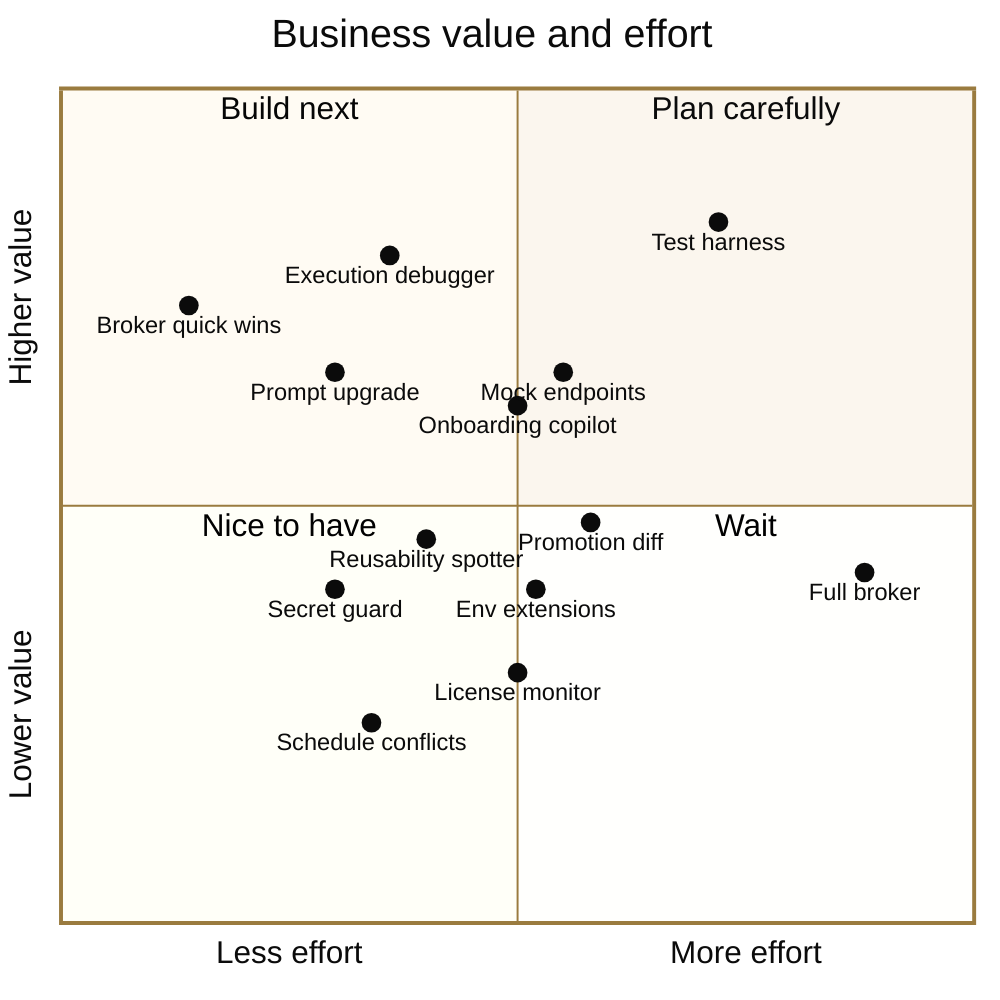

# Mod Ideas

Ideas for mods we could build next, starting with Boomi and integration work. The ideas below aren't built yet. Treat it as a brainstorm: add ideas, argue with the rankings, and claim one to build.

**Built from this page so far:**
- The Companion guardrail, built as the boomi-standards mod and then set aside; see [Boomi standards: bring it back](#boomi-standards-bring-it-back).
- The deployment watcher, folded into the [boomi-dashboard](boomi-dashboard/README.md) mod: a live summary of a Companion session that watches components for changes. (Polling the environment's runs is set aside for now; see [Dashboard follow-ups](#dashboard-follow-ups).)
- The first half of the execution debugger, in the dashboard: **Why?** reads a failed run's process log and **Ask Claude to fix** drafts the request. A session report (`/bc-dashboard report`) came with it.
- Dashboard follow-ups: **Run again** for a failed test, a spend budget (`budgetUsd`), and the next step (deploy, then test) suggested in the prompt box.
- Guardrails at a glance: the dashboard's **Guardrails** section shows the runtime's state, and what boomi-standards blocked once that mod is back.
- Companion's activity log as a second source, and a new-session banner with the last session's recap and tips.
- A report style switch: `reportStyle` (`exosphere` or `expressive`) for the dashboard's HTML report.
- The first half of the prompt upgrade, in the dashboard (0.41.0): prompt tips for Boomi work, an upgraded prompt, and a question before a secret is sent. Then the Prompt tab beside the pane (0.42.0); see [Boomi prompt upgrade](#boomi-prompt-upgrade).
- Platform changes in the report (0.40.0): every change the session made in Boomi, with the budget override that let it through, in both reports and as a CSV.

The [boomi-runtime](boomi-runtime/README.md) mod shows what a mod can do. It provisions a temporary Boomi runtime in the session, smoke-tests it, hands it to Boomi Companion through a shared `.env` and tears everything down at the end, while keeping the Platform API token out of the conversation. Mods can add:

- slash commands
- tools Claude can call
- network, process and file access
- session state
- lifecycle hooks, including hooks before and after every tool call
- status lines and panes

## What makes a good mod idea

A mod is worth building over a skill or a script when it uses something only a mod has:

- **Work that outlasts Claude's reply.** Polling, installs and watchers keep running in the background while you keep chatting.
- **A hook on every tool call.** A mod can check, refuse or redact what Claude does before or after it happens. `boomi-runtime` uses this to guard the API token.
- **The session's own runtime.** The Boomi runtime runs in the session's container, so a mod can put files in local folders the runtime reads, read its execution logs on disk, and start local services for it to call.
- **Commands that cost no tokens.** Slash commands run the same way every time without Claude interpreting them.

One limit to design around: **the Claude Code web app doesn't show status lines or panes yet.** An idea that depends on a pane should also work through a slash command.

## Value and effort

| Rank | Idea | Business value | Effort | Status |
|---|---|---|---|---|
| Next | [Boomi standards: bring it back](#boomi-standards-bring-it-back) | High | Small | Built, set aside; to restore soon |
| Next | [The dashboard across all of Boomi Companion](#the-dashboard-across-all-of-boomi-companion) | High | Small first, medium in all | Steps 1-7 built (0.13.0-0.24.0), and **Why?** on a failed BDI run (0.35.0) |
| 1 | [Execution debugger](#execution-debugger) | High | Small to medium | Log reading built into the dashboard; per-step documents next |
| 2 | [Credential broker: quick wins](#credential-broker) | High | Small | Secure-storage token tried and removed; API-user guide kept |
| 3 | [Boomi prompt upgrade](#boomi-prompt-upgrade) | Medium to high | Small | Built: checks, tips and the secret question (0.41.0), the Prompt tab (0.42.0), holding a prompt, the nudge and Regenerate with retrieval (0.43.0), confirm by default (0.44.0), a fitted tab (0.45.0), the look-around nudge (0.46.0) |
| 4 | [Process test harness](#process-test-harness) | High | Medium to large | Idea |
| 5 | [Mock endpoints](#mock-endpoints) | Medium to high | Medium | Idea |
| 6 | [Boomi onboarding copilot](#boomi-onboarding-copilot) | Medium to high | Medium | Idea |
| 7 | [General secret guard](#general-secret-guard) | Medium | Small to medium | Idea |
| 8 | [Reusability spotter](#reusability-spotter) | Medium | Small to medium | Idea |
| 9 | [Promotion diff](#promotion-diff) | Medium | Medium | Idea |
| 10 | [Environment extensions manager](#environment-extensions-manager) | Medium | Medium | Idea |
| 11 | [Credential broker: full](#credential-broker) | Medium | Large | Idea |
| 12 | [License and connection-usage monitor](#license-and-connection-usage-monitor) | Low to medium | Medium | Idea |
| 13 | [Schedule conflict detector](#schedule-conflict-detector) | Low to medium | Small to medium | Idea |

## The ideas

### Boomi standards: bring it back

**Hold Companion's components to the team's standards before they reach Boomi. Built, then set aside; it comes back in the near future.**

- **What it was:** the boomi-standards mod (0.2.0) read each component's XML before Companion created, pushed or deployed it, and refused the call when it broke a rule: naming per component type, allowed folders, forbidden text such as production hosts, passwords typed into password fields, and a Try/Catch in every process. Teams set the rules in a checked-in `boomi-standards.json`. Its tests passed and it was run against a live Boomi account.
- **Why it's out:** set aside in October 2026 to focus on the dashboard. Nothing was wrong with it.
- **To restore:** `git checkout cd07899 -- boomi-standards`, then add it back to the **Mods** table in the [README](README.md), to `PAGES` and `COPY_PATHS` in `site/build.py`, and to the `paths` in `.github/workflows/pages.yml`. Restore the standards half of checklist item B10, and the boomi-standards links in the dashboard README (**Guardrails**, and **⚠ save blocked** in the stages table).
- **Already waiting for it:** the dashboard still reads boomi-standards' `activity` state for its **Guardrails** section, with tests, so that comes back without changes.
- **Rules to add when it returns:**
  - **Sensitive fields:** a profile field whose name looks like personal or payment data (SSN, date of birth, card number, bank account) needs a classification the team sets, or the save is refused.
  - **Standards from one place:** read `boomi-standards.json` from a shared repository or URL the team names, so every session uses the same rules without copying the file.
- **Before it returns:** run `claude plugin validate` and `claude plugin test` on it against the Claude Code of the day, and recheck it against Companion's current XML format.

### Execution debugger

**Show Claude which step of a process failed, and what data it had at that point.**

- **Problem:** When a test execution fails, Claude often sees little more than `ERROR` and has to guess.
- **Idea:** A `/boomi trace <execution>` command and a `trace` tool Claude can call. They pull the execution's process log and each step's documents from the local runtime, then summarize where the documents stopped and why.
- **Why a mod:** The runtime runs in the session's container, so the execution artifacts are on local disk. This extends the existing `logs` tool.
- **Open question:** Which execution artifacts the runtime keeps on disk by default, and for how long.
- **Built so far:** The dashboard's **Why?** button reads the process log through Companion's own script. What's left is each step's documents from a local runtime.

### Credential broker

**Let mods and skills call the Platform API without the token ever being visible in the session.**

- **Quick wins:**
  - **Tried and removed:** the token in Claude Code's secure storage, handed to Companion's scripts only while one ran. Tests and a fake-token probe passed, but in real use it broke Companion, so it came out (boomi-runtime 0.3.0). Don't retry it without a live Companion session to test against.
  - **Kept:** a dedicated API user with only the permissions the work needs, and how to rotate its token, in the [boomi-runtime README](boomi-runtime/README.md#a-dedicated-api-user).
  - Still to try: the cloud environment's network secrets, which add credentials in the proxy.
  - Still to try: check the API user's roles against what the session's work needs, and say which ones it could drop (least privilege).
  - Still to try: a banner tip when the token is due for rotation. Open question: whether the Platform API shows a token's age.
- **Full broker:** The mod holds the token and offers a `boomi_api` tool that makes allow-listed Platform API calls for other mods and skills, so none of them needs the token.
- **Limit:** Companion's scripts read the token from `.env`, and the broker can't change that. It protects everything except Companion's own calls, which is why the full version ranks lower than the quick wins.

### Boomi prompt upgrade

**Spot what a Companion prompt leaves out for Boomi work, and suggest a better one before Claude acts on it. To be built into the dashboard.**

- **Problem:** Prompts in a Companion session are often short and lean on context only the person has: "deploy it", "test it", "fix it, it's still failing". Claude then guesses which process "it" is, which environment to deploy to, what to test with, and what failed, or runs three big steps (build, deploy, test) without stopping. A guess costs tokens, and a wrong environment can cost more.
- **Idea:** The dashboard checks each prompt typed in a Companion session and, when something is missing, says what and offers an upgraded prompt.
  - **Cheap checks, no model call:** "it" or "the process" with no component named; a deploy with no environment; a test with no process or test data; wording that suggests production; several big steps in one prompt; "fix it" with no error, log or execution ID; a new process with no source, target, trigger or data format, or a map with no profiles; and a token- or password-shaped string.
  - **Facts, not guesses:** each tip names the likely answer from what the dashboard already knows: the component last edited, the environment the session points at, the last failed test's execution ID. Anything unknown stays a `[placeholder]`; it never invents an ID or a name.
  - **Example:** `deploy it and test it, still failing` gets four tips ("it" is Orders Sync; no environment, the session points at Dev; last failed test not mentioned; three steps in one) and the upgrade "Deploy the process Orders Sync to the Dev environment. The last test failed (execution exec-3f2a…): read its process log, tell me the cause, and fix it. Then test it again with [test data] and stop to show me the result before changing anything else."
  - **Automatic:** it hooks every prompt (`prompt.submit`) and stays silent outside a Companion folder, using the dashboard's own check of which Companion plugins are on. It skips slash commands, prompts typed while Claude works, short replies ("yes", "go on") and anything starting with `>`.
  - **Suggest, don't block:** `promptCheck` is `off`, `suggest` (default) or `confirm`, next to `budgetEnforce`. In `suggest` the tip shows in the status line, the banner and `/bc-dashboard prompt`, and the prompt goes through. In `confirm` a flagged prompt asks **Send as is**, **Use the upgrade** or **Edit**; the last two put the text back in the prompt box. **A secret in the prompt always asks**, even in `suggest`, since once sent it's in the transcript.
  - **A Prompt tab:** the pane opens a second pane, so Claude Code's own tab row shows **Session** and **Prompt · 2 tips** side by side, like a browser's. The Prompt tab shows the original and the upgrade side by side with **Use the upgrade**, **Upgrade with a model**, **Send as is** and **Dismiss** above them. `promptView` is `auto` (bring the tab forward when a tip lands, and Session back when Claude starts working), `manual` (open the tab without switching) or `off`. A prompt with nothing to flag opens no tab.
  - **A model only on demand:** `/bc-dashboard prompt upgrade` asks a fast model to rewrite the masked prompt with the same facts and shows what it cost; `/bc-dashboard prompt use` puts the upgrade in the prompt box.
  - **Habits:** the report counts tips and how many were followed (`Prompt tips: 4 · 3 followed`), and Review names a habit ("You often deploy without naming the environment").
  - **Privacy:** prompts are masked with `mask()`, stay in the session's state and are never logged; across sessions only the per-check counts are kept.
- **Why in the dashboard, not a mod of its own:** the dashboard already has everything it needs (which Companion plugins are on, the session's components, environment and failed runs, `mask()`, a `prompt.submit` hook, the pane, the prompt box, the report and Review), so a separate mod would mostly be plumbing between the two: shared state, a versioned contract, and button presses passed through state. It also starts with the dashboard, with nothing more to load. `promptCheck: off` turns it off completely, and the checks live in their own file of plain functions with tests. Asking about secrets changes how the dashboard behaves, so the CHANGELOG and the upgrade notice say so.
- **Why a mod:** it needs a hook on every prompt before it reaches the model, which a skill can't have. The cheap checks cost no tokens, and `/bc-dashboard prompt` covers Claude Code on the web, where no pane or status line shows.
- **Open questions:**
  - Whether opening a pane that's already open brings its tab forward; `auto` depends on it, and without it acts like `manual`.
  - Whether `manual` can add the tab without taking focus, and how the tab row looks beside the banner on a narrow pane.
  - Whether the `confirm` question and the refilled prompt box work on the web as in the terminal.
  - How often the checks flag real Companion prompts by mistake; that decides which checks are on by default.
  - Later: let a team add its own niche to the rewrite. The seams are in place (0.56.0): what Claude asks before each kind of work is one table (`TASK_QUESTIONS`), and `rewriteSystem()` takes extra guidance lines. Still to decide: where a team keeps them (a file in the Companion folder, or a section in Companion's own docs that retrieval prefers), whether a team can add checks of its own beside the rewrite's guidance, and how a shared rule file is reviewed. Also later: a short "what Claude asks before X" section per task in Companion's docs, so the rewrite's questions grow with the skill.
  - Later: checks for the other Companion plugins (a BDI flow or a Data Hub model named as "it").

### Process test harness

**Run sample documents through a deployed process and compare the outputs with expected results.**

- **Problem:** Integrations rarely have regression tests, so a mapping change can quietly break a field nobody checked.
- **Idea:** A `tests/` folder of input documents and expected outputs per process. `/boomi test <process>` deploys a test wrapper, runs every case and reports differences field by field. Claude can call the same command after each change.
- **Why a mod:** The Platform API's execute call takes process properties, not documents. The local runtime gets around that: a Disk connector in the wrapper reads inputs from a harness folder and writes outputs to another, so the mod controls both ends with no extra infrastructure.
- **Open questions:**
  - Overlap with Companion's own testing.
  - Generating inputs: a new case could start from sample documents (JSON, XML, flat file, EDI) built from the process's profiles. Generating them is skill work; the harness only runs them.
  - The Platform API can't delete components, so the wrapper must be created once and reused.

### Mock endpoints

**Test processes that call external systems without touching those systems.**

- **Problem:** Testing a process that posts to Salesforce, NetSuite or a partner API needs access, credentials and test data in that system.
- **Idea:** The mod starts a local mock HTTP server for the session. It records real responses once, or serves hand-written ones, and replays them. `/mock record`, `/mock replay` and `/mock show` manage it, and the requests a process sent can be checked in tests.
- **Why a mod:** It starts a background process for the session and stops it when the session ends. The runtime is in the same container, so it can reach the mock on `localhost`.

### General secret guard

**Apply the token guard to every credential, not only Boomi's.**

- **Idea:** Move the guard and redaction out of `boomi-runtime` into a reusable mod configured with a list of variable names and file patterns. It then covers Salesforce, AWS and partner keys too.
- **Why now:** It matters more once mock endpoints and test harnesses bring more systems into a session.

### Promotion diff

**Show what would change before a release moves from TEST to PROD.**

- **Idea:** Compare the packaged component versions deployed to two environments and write release notes from the differences. Optionally, refuse to promote anything this session hasn't smoke-tested or run through the test harness.
- **Care needed:** It touches production. Start read-only, so it reports and never deploys.
- **Environment snapshot:** the same read saved to a file (deployed versions, and extensions with secrets masked), so an environment can be compared with how it was last week, not only with another environment.

### Environment extensions manager

**View and set connection settings and process properties per environment, with secrets masked.**

- **Idea:** `/boomi ext show <environment>` and `/boomi ext set` use the same masking as `/boomi env`, so Claude can configure an environment without seeing its passwords.
- **Open question:** How much Companion already covers.

### Boomi onboarding copilot

**Get anyone productive with Companion from their first message.**

- **Problem:** A new Companion user needs a `.env` with the right credentials, an environment and a runtime that's online, the team's standards and the dashboard, before the first build works. Each gap shows up later as a failure that looks like something else: a test refused with HTTP 400 because the atom is offline, a deploy to the wrong environment, a missing `BOOMI_ENVIRONMENT_ID`.
- **Idea:** At session start in a Companion workspace, check the setup and say what's missing in one list: credentials present (never shown), the account reachable, the environment and test runtime set and online, Companion's plugins installed, the dashboard and standards loaded. `/boomi onboard` walks through fixing each item, using bc-integration's `env-setup-guide` skill for credentials.
- **Why a mod:** It runs at session start without anyone asking, before Claude's first turn, and its checks run the same way every time without spending tokens. A skill only helps once someone thinks to call it.
- **Open questions:**
  - How much of this belongs in boomi-runtime's `/boomi doctor`, which already checks the host, credentials and network.
  - Whether it should install missing pieces or only list them.

### Reusability spotter

**Point out an existing component before Claude builds a new one like it.**

- **Problem:** Claude builds a new connection, profile or map without checking for one that already does the job, so accounts fill with near-duplicates.
- **Idea:** Before Companion creates a component, search the account for components of the same type with a similar name or the same endpoint, and tell Claude about them (it doesn't refuse). In `confirm` mode, ask first, the way the budget gate does.
- **Why a mod:** A hook on Companion's create runs every time, whether or not Claude thinks to search first.
- **Open questions:**
  - What "similar" means for each component type: name, connection URL, profile fields.
  - The cost of a component search before every create, and whether to cache the account's components for the session.

### License and connection-usage monitor

**Show what the session's deploys do to the account's connection licenses, and what's sitting unused.**

- **Problem:** Boomi licenses connections by class (standard, enterprise), and a deploy that brings in a new connection uses up a license. Nobody finds out until the account runs out. Deployed processes and connections nobody runs any more keep licenses tied up.
- **Idea:** Before a deploy, warn when it would use a new connection license and how many are left. `/boomi licenses` lists what's used and free per class, and the deployed components with no runs in a set time (idle resources).
- **Why a mod:** The warning is a hook on Companion's deploy. The listing alone could be a script.
- **Open questions:**
  - Which Platform API objects give license counts and per-connection use, and whether the API user needs extra rights.
  - Whether the dashboard's budget gate should be able to stop a deploy that would go over.

### Schedule conflict detector

**Warn before a deploy adds a schedule that collides with others on the same runtime.**

- **Problem:** Processes scheduled for the same minute on one runtime compete for it, and a new schedule can slow down or delay the ones already there.
- **Idea:** When Claude sets or deploys a process schedule, compare it with the other schedules on the runtimes in that environment and warn about overlaps, with the busiest times.
- **Why a mod:** A hook on the schedule change and the deploy, so the check happens before the change, not after a slow night.
- **Open question:** How often teams set schedules through Companion rather than in the Boomi UI; if rarely, a report command is enough.

### The dashboard across all of Boomi Companion

**Show every Companion plugin's work in the dashboard, not only bc-integration's.**

- **Problem:** Boomi Companion is six plugins ([boomi-companion](https://github.com/OfficialBoomi/boomi-companion)), and the dashboard only follows one. It recognizes scripts named `boomi-*.sh`, so every run of Data Hub's `datahub-*.sh`, BDI's `bdi-*.sh`, Agentstudio's `agentstudio-*.sh` and connector development's `connectordev-*.sh` is invisible, failures included. A Marketplace install shows only as a generic "Ran marketplace-install".
- **Idea:** Teach the dashboard each plugin's scripts, and give each product what fits its work: a step feed and **Needs attention** for all of them, and a section of its own where the product has state worth watching.
- **Why a mod:** The same reason the dashboard exists: it follows Claude's tool calls, so it costs no tokens and sees every run as it happens.

**What each plugin does, and what the dashboard can see.** Read from each plugin's own scripts on October 13, 2026:

| Plugin | Version | What it does | Scripts and output | Credentials | Activity log |
|---|---|---|---|---|---|
| bc-integration | 1.0.83 | Builds integration processes | `boomi-*.sh`: `SUCCESS:` / `ERROR:` lines | `BOOMI_*` | Yes (opt-in) |
| bc-marketplace | 0.2.10 | Searches and installs Marketplace recipes as reference samples | `boomi-marketplace-install.sh`, `-supporting-materials.sh`: `SUCCESS: Installed '<bundle>'` | `BOOMI_*`, through bc-integration's `boomi-common.sh` | Yes: `marketplace-install` with the bundle and the copied component IDs |
| bc-datahub | 0.2.12 | Designs and operates Data Hub master data: models, sources, quality steps, deployments, quarantine, golden records | `datahub-{model,source,deployment,quarantine,golden-record,repository,connection}.sh <verb>`: the API's response on success, `ERROR: HTTP <code>` on failure | `BOOMI_*`, plus `DATAHUB_REPO_*` for the repository API | No |
| bc-bdi | 0.2.5 | Operates BDI (formerly Rivery) ELT flows: runs, CDC, connections, environments | `bdi-{flow,connection,cdc,env,variable,dataframe,logicode}.sh <verb>`: JSON on success, `ERROR:` and `WARNING:` lines on failure | Its own: `BDI_API_URL`, `BDI_API_TOKEN`, `BDI_ACCOUNT_ID`, `BDI_ENVIRONMENT_ID` | No |
| bc-agentstudio | 0.1.42 | Builds and runs Agentstudio AI agents: agents, tools, sources, packages, deployments, sessions | `agentstudio-{agent,tool,source,deployment,session}.sh <verb>`: JSON | `BOOMI_*` and Agentstudio's URLs | Yes (opt-in): `agent-create`, `tool-update`, `deployment-deploy`, `session-*` |
| bc-connectordev | 0.0.50 | Builds, tests and publishes custom connectors with the Connector SDK | `connectordev-{init,version,group,descriptor-lint,doctor,version-change}.sh`: JSON, `WARNING:` / `ERROR:` lines | `BOOMI_*` | No |

**What to build, in order:**

1. **Every plugin's steps (small; built in 0.13.0).** Recognize all six plugins' scripts and verbs, and word their steps for a person: "Deployed Data Hub model Customer", "Ran BDI flow Orders Sync", "Deployed agent Support Triage", "Uploaded connector version 1.4". A failed run (a non-zero exit, `ERROR:`) goes under **Needs attention** with its error line. Read-only verbs (`list`, `get`, `query`, `search`) stay out of the feed, as bc-integration's searches do now. Each step carries its product, and the pane, the status line and `/bc-dashboard report` group by product when there's more than one. Spend per product comes free, since each step already carries what Claude spent getting to it.
2. **Marketplace recipes as components (small; built in 0.16.0).** An install already logs the components it copied. They join **Components this session** as "installed from recipe <bundle>", so the steps Claude takes next with them (pull, edit, push) read as one story.
3. **BDI flow runs (medium; built in 0.17.0, following Claude's own status checks; **Why?** on a failed run built in 0.35.0).** `bdi-flow.sh run` starts a run; the dashboard follows its status (the plugin's own `status` verb, or BDI's API with BDI's credentials) and puts a failed run under **Needs attention** with its `error_description`. **Why?** reads the run's logs with `bdi-flow.sh logs`, as it reads a Boomi process log now. This is the BDI half of the set-aside **Process runs in Boomi**, and the same pattern.
4. **Data Hub stewardship (medium; built in 0.19.0, following Claude's own deploy status checks and quarantine queries).** A model deploy shows its status until it settles. A **Data Hub** section shows quarantined entities per universe that Claude touched, from `datahub-quarantine.sh query`, so new quarantines are news. Golden-record end-dates and restores are listed in the report, since they change master data.
5. **Agentstudio agents (small to medium; built in 0.20.0, from Claude's own create, package, deploy and session runs).** Each agent's stages, as components have now: created, updated, packaged, deployed. `session-*` runs count as test conversations, with how many and how they ended.
6. **Connector releases (small; built in 0.21.0, from Claude's own lint, validate, upload and version-change runs).** A connector's stages: descriptor linted (with its warnings), version validated, uploaded, version changed. A lint or validate warning goes under **Needs attention**.
7. **Know which plugins are installed (small; built in 0.24.0, from `claude plugin list --json`, else Claude Code's plugin files).** The pane shows only the sections that apply, and the new-session tips mention what's there.

**Open questions:**
- Data Hub, BDI and connectordev print the API's own JSON on success, and their responses aren't documented in the plugins. Each needs real output captured into tests before its wording is trusted, as bc-integration's v1.0.83 lines were.
- BDI has its own credentials and API host. Reading run status directly needs network access to that host; following the plugin's own `status` calls needs none.
- Agentstudio's responses name their fields (`id`, `package_id`, `deployment_id`, `session_id`) but their full shape isn't documented, so 0.20.0 reads them leniently: a package's version and the agent's name on package and deploy responses need real output (checklist G13). A turn a guardrail blocked comes back as an ordinary reply carrying the agent's `blocked_message`, so the dashboard counts it as answered.
- The descriptor lint checks against the SDK's schema and never warns; warnings come from `connectordev-version.sh validate`. An upload's `versionId` and a version change's status aren't documented beyond their names, so 0.21.0 reads them leniently (checklist G15).
- Only bc-integration, bc-marketplace and bc-agentstudio write the activity log, so the other three are seen only through Claude's tool calls.
- How many people use more than one of these plugins in one session; if few, a per-product view may matter more than a combined one.

### Dashboard follow-ups

Smaller additions to the [boomi-dashboard](boomi-dashboard/README.md) mod that build on what it already tracks:

- **Process runs in Boomi, again:** up to 0.10.0 the dashboard polled the runs on the runtimes attached to `BOOMI_ENVIRONMENT_ID` and showed this session's components' runs (tests, listener calls, schedules), toasting new failures. It was set aside in 0.11.0 to come back to later. The plain functions (`recentRuns`, `sessionRuns`, `runsOf`, `newFailures`) and the Platform API client's `environmentAtoms` and `recentRuns` are still in the mod with their tests; what's needed is the polling, the pane section and the text and report sections again.
- **Production runs: SLAs and resubmits.** Once runs are polled again, flag a run that takes longer than a set time for its process, and offer **Run again** for a failed production run, asking first the way `confirm` does.
- **Where the session is pointed:** show the Boomi account, the environment and the test runtime in the pane and the status line, not only in the HTML report, with the runtime's state (✓ online, ⚠ offline). A test refused with HTTP 400, "cannot be executed on atom", because the runtime is offline then reads as that, not as a failed test.
- **An environment and release-window guard:** the budget gate's `warn`, `confirm` and `block`, applied to deploys to an environment marked as production, or outside a release window the team sets. Open question: where the production mark and the windows live (a setting, or Boomi's environment classification).
- **Who uses this component, before a push:** before Claude saves a component, list the deployed processes that use it, so a change to a shared profile or connection isn't a surprise. The same references could draw a map of the session's components and what uses what, in the HTML report. Open question: whether the Platform API's component references are quick enough to read before every push.
- **Progress on long operations:** elapsed time and the latest status for deploys, Data Hub deploys and BDI runs while they run, in the pane and the banner. `◐ deploying` and `◐ run started` already show; what's missing is how long, and the same for bc-integration's deploys.
- **What each process does, in the report:** under each process in the HTML report's **Components this session**, a short summary read from its XML: its shapes in order, the connections and endpoints it calls, its maps and their profiles, and its process properties. It's written when the report is made, from the version saved last, so it matches what the session left behind. A reviewer who doesn't open Boomi can see what changed hands. (Docs kept up to date on every save, as their own mod, are on hold.)
- **Demo mode:** a sample session, the one the test kit already draws `assets/pane-*.png` from, that also produces a sample HTML report and components CSV without a Boomi account, with one command to make them all again after a release.
- **Promotion diff and mock endpoints** would each show up as a section in the pane once they exist.

## Add an idea or claim one

- **Add an idea:** Open a pull request that adds a section under [The ideas](#the-ideas) and a row in the table. Give it a **problem**, the **idea**, **why a mod** (what it needs that a skill or script can't do) and any **open questions**. Rough is fine.
- **Disagree with a ranking:** Change it in the same kind of pull request and say why in the description.
- **Claim an idea:** Set its status to **In progress** with your GitHub handle. Build it as a mod following the [project conventions](CLAUDE.md), and when it ships, move it from this page to the **Mods** table in the [README](README.md).
