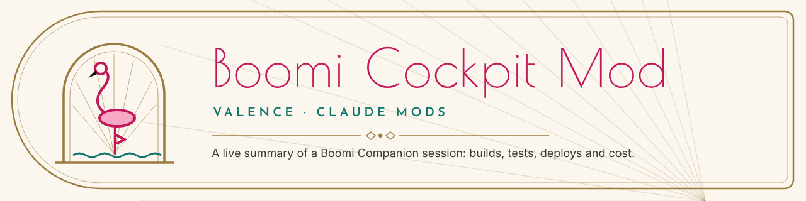
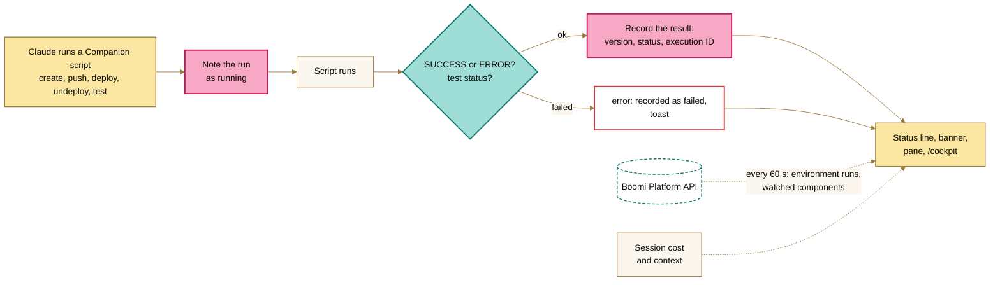

<picture>
  <source media="(prefers-color-scheme: dark)" srcset="assets/banner-night.png">
  
</picture>

# Boomi Cockpit Mod

A Claude Code mod that keeps a live summary of a [Boomi Companion](https://github.com/OfficialBoomi/bc-integration) session: which components Companion created and pushed, which tests passed or failed, what it deployed, and what the session has cost so far. With Companion's credentials, it also shows how the environment's processes are running and whether someone else changed a component you're watching.

You see it as a status line, a banner above the prompt, a pane and toasts. `/cockpit` shows the same summary as text wherever those aren't available, including Claude Code on the web.

> **Prototype.** Built and tested against Companion's scripts and their output. Not yet run against a live Boomi account.

## What it does



The cockpit gets the session's own activity from Claude's shell commands, so it makes no Platform API calls for it. When Claude runs one of Companion's scripts, the cockpit records it as running, lets it run, then reads the result from the script's output:

| Companion script | What the cockpit records |
|---|---|
| `boomi-component-create.sh <file>` | The component's name and its new ID |
| `boomi-component-push.sh <file>` | The component's name and its new version, or that nothing changed |
| `boomi-deploy.sh <file>` | The deployed process and its package, or the error |
| `boomi-undeploy.sh` | The deployment removed, or the error |
| `boomi-test-execute.sh --process-id <id>` | The execution's status (`COMPLETE`, `ERROR`, ...) and ID. An `ERROR` or `ABORTED` run is a failed test. |

The script still runs as usual. If another mod, such as [boomi-standards](../boomi-standards/README.md), refuses the call first, the cockpit records it as **blocked**, with the refusal's first line.

When something is fixed, the cockpit shows the fix: in the counts, a later run of the same component or process replaces the earlier failure. The full history stays in the pane and in `/cockpit`.

## What you see

**Status line**, one entry per area, each with an icon and a label:

```text
Cockpit ✓ 4 built · ✗ 1 test failed · ✓ 1 deployed · ⚠ 2 platform errors · $1.84
```

**Banner above the prompt**: once there's Companion activity, one row with the state of each area (Builds, Tests, Deploys, Platform), plus **Open** to open the pane and **Hide** to dismiss the banner. `/cockpit banner` brings it back.

**Pane**: each area with its counts; the session's cost and how full the context is; recent Companion activity, newest first; the environment's recent runs; and the watched components. The pane opens with the session's first Companion script.

**Toasts** for what you'd want to know without looking:
- a failed or blocked create, push, deploy or test
- a finished deploy or test
- a new failed run in the environment
- a change to a watched component made by someone else

| Status | Icon | Means |
|---|---|---|
| Healthy | ✓ | Passed, deployed, unchanged |
| Warning | ◐ | Running, completed with warnings, a watched component changed |
| Serious | ⚠ | Blocked by another mod, a platform error |
| Critical | ✗ | Failed |

## The Platform API side

With Companion's credentials, the cockpit also polls the Platform API every 60 seconds by default. It only reads.

- **Environment runs.** The newest executions on the runtimes attached to `BOOMI_ENVIRONMENT_ID`, with a toast for each new failure. The first poll is the baseline, so failures from before the session don't raise toasts.
- **Watched components.** `/cockpit watch <component ID or XML file>` adds a component to the watch list. Each poll reads the component's current version. When the version changes and Companion's API user (`BOOMI_USERNAME`) didn't make the change, the cockpit flags it and shows a toast, so you know someone else edited a process you're working on. `/cockpit seen` clears the flags. The watch list is kept across sessions.

The cockpit reads the credentials from Companion's `.env`, falling back to environment variables for any that are missing. They're the same ones Companion and [boomi-runtime](../boomi-runtime/README.md) use: `BOOMI_API_URL`, `BOOMI_USERNAME`, `BOOMI_API_TOKEN`, `BOOMI_ACCOUNT_ID` and `BOOMI_ENVIRONMENT_ID`.

The token is used only in the requests' `Authorization` header. The cockpit never stores, shows or logs it, and its error messages carry only the HTTP status, never the platform's reply. Without credentials, everything else still works and the Platform line explains what's missing.

## Commands and tools

| Command | Tool Claude calls | Does |
|---|---|---|
| `/cockpit` | `summary` | The whole summary as text; opens the pane where the surface has one. |
| `/cockpit poll` | | Polls the Platform API now, then shows the summary. |
| `/cockpit watch <id\|file>` | `watch` | Watches a component, given its ID or the XML file Companion created. |
| `/cockpit unwatch <id\|name>` | | Stops watching it. |
| `/cockpit seen` | | Marks watched changes as seen. |
| `/cockpit banner` | | Shows the banner again after **Hide**. |

The tools are listed to Claude as `mcp__boomi-cockpit__summary` and `mcp__boomi-cockpit__watch`. With them, Claude can report progress or find what failed without reading back through the conversation.

## Setup

Load it alongside the [boomi-runtime](../boomi-runtime/README.md) and [boomi-standards](../boomi-standards/README.md) mods, or on its own with Companion:

- **Claude Code on the web:** add the folder to the environment's `CLAUDE_CODE_PLUGIN_DIRS`, separating mods with `:`, for example `CLAUDE_CODE_PLUGIN_DIRS=/home/user/ClaudeMods/boomi-runtime:/home/user/ClaudeMods/boomi-standards:/home/user/ClaudeMods/boomi-cockpit`.
- **Terminal:** `claude --plugin-dir boomi-cockpit`.

The session's own activity needs nothing extra. The Platform API side needs Companion's credentials and network access to `BOOMI_API_URL` (`api.boomi.com`). Set `pollSeconds` to `0` to turn polling off.

## Settings

Set these under `/config`, or in settings under `pluginConfigs["boomi-cockpit"].options`:

| Setting | Default | |
|---|---|---|
| `envFile` | `.env` | Companion's `.env`, relative to the session's working directory. |
| `pollSeconds` | `60` | How often to poll the Platform API. `0` turns polling off. |
| `toasts` | `true` | Show a toast for failures, finished deploys and tests, and watched changes. |
| `banner` | `true` | Show the one-row summary above the prompt. |

## Limits

- **The Claude Code web app doesn't show status lines, panes, banners or toasts yet.** On the web, use `/cockpit`, or ask Claude, which calls the `summary` tool.
- The cockpit recognizes Companion's scripts by name in Bash commands and reads their `SUCCESS:` and `ERROR:` lines. A component sent to the platform another way, such as `curl` straight to the Platform API, doesn't show up. A change to the scripts' output could need a change here.
- When one command runs several scripts, each is judged from the command's whole output.
- A call another mod refuses shows as blocked only when that mod's refusal reaches the cockpit, which depends on the order the mods' hooks run in.
- Environment runs are the newest executions on the environment's runtimes. They include runs from schedules and other people, not only this session's.
- The cost is the session's total so far, as `/cost` reports it, not just Companion's share.

## How it works

| Capability | Engine call | What it does in this mod |
|---|---|---|
| Tool-call hook | `tool.call` on `Bash` | Notes each Companion script run, lets it run, then reads how it went. |
| Session usage | `$.session.usage` | The session's cost and how full the context is, as the status line has them. |
| Network | `$.http.fetch` | Read-only Platform API queries: `EnvironmentAtomAttachment`, `ExecutionRecord` and `ComponentMetadata`. |
| Timers | `$.clock.every` | Refreshes the status line every 5 seconds and polls the platform every `pollSeconds`. |
| Files | `$.fs` | Reads component XML for names and IDs, and Companion's `.env` for the credentials. |
| Session state | `$.state` | The activity, the platform results and the watch list that the banner and pane read. |
| Store | `$.store` | Keeps the watch list across sessions. |
| Slash command | `$.command.register` | `/cockpit` and its actions. |
| Tools for Claude | `$.tool.register` | `summary` and `watch`. |
| Display | `$.ui.status`, `ui.render` (`AbovePrompt`, `Pane`), `$.ui.toast` | The status line, the banner, the pane and the toasts. |

## To do

- [ ] Run it against a live Boomi account and Companion session.
- [ ] Link a failed test to its trace once the [execution debugger](../IDEAS.md#execution-debugger) exists.
- [ ] Show [mock endpoints](../IDEAS.md#mock-endpoints) traffic once that mod exists.
- [ ] Read Companion's activity log (`.activity-log/activity.jsonl`, written when `BOOMI_COMPANION_LOG_ACTIVITY=1`) as a second source.

## Development

Built against Claude Code 2.1.296.

```bash
cd boomi-cockpit
claude plugin validate .
claude plugin test .
```

Two files hold plain functions:
- `hooks/activity.ts` reads Companion's commands and output and builds the counts, the status line and the summary. It has unit tests.
- `hooks/platform.ts` is the Platform API client. The engine tests cover it.

Everything that touches the engine is in `hooks/register.tsx`, because the engine only follows `$` within one file. The engine tests also draw the banner and the pane on the terminal and desktop surfaces.
