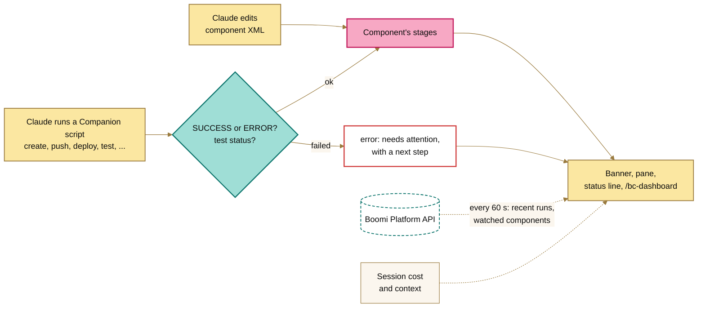

<picture>
  <source media="(prefers-color-scheme: dark)" srcset="assets/banner-night.png">
  
</picture>

# Boomi Companion Dashboard Mod

A Claude Code mod that shows where your [Boomi Companion](https://github.com/OfficialBoomi/bc-integration) build stands while Claude works. It tracks each component Claude edits, saves to Boomi, deploys and tests, and shows what failed with what to do next. It also shows what the session has cost so far. With Companion's credentials, it adds the live environment's recent runs, and warns when someone else changes a component you're working on.

You see it as a banner above the prompt, a pane, a status line and toasts. `/bc-dashboard` shows the same thing as text wherever those aren't available, including Claude Code on the web.

> **Prototype.** Built and tested against Companion's scripts and their output. Not yet run against a live Boomi account.

**Install it on your own computer:** paste the prompt in [INSTALL.md](INSTALL.md) into Claude Code.

## What you see

**The banner** above the prompt shows the latest step and what needs attention. It stays hidden until Companion does something.

```text
◆ BC Dashboard ✓ Saved Orders Sync to Boomi (v4) 2m ago │ ✗ 1 needs attention │ 3 components │ 338k tokens · $0.54   [ Open ]  [ Hide ]
```

**The pane** has the whole picture. It opens the first time Claude edits or saves a component:

 

- **Title band:** shows **● WORKING** while Claude works on a turn and **◇ IDLE** between turns.
- **Under it:** how long the session has run, how many components it has touched, and the model that answered last, such as Opus 5.5.
- **Theme buttons:** **Day**, **Night** and **Terminal**; see [Themes](#themes).
- **Gauges:** the session's tokens and spend, with the last step's share, and how full the context window is. Under them, a sparkline of the tokens each step took.
- **The flamingo:** an 8-bit flamingo beside the gauges. While Claude works, it paces back and forth with flapping wings, facing the way it walks and turning at each end. While Claude is idle, it stands on one leg where it stopped. The `flamingo` setting turns it off.
- **Needs attention:** what's still broken, each with a next step.
- **Components this session:** each component's stages, and the tokens and spend it took across all its steps.
- **Claude's latest steps:** what Claude just did with Companion, newest first, each with the tokens it took.
- **Process runs in Boomi:** every execution in your Boomi environment in the last 24 hours: this session's tests, schedules and other people's runs. If it isn't connected yet, it says what's missing.

### Themes

| Theme | Looks like |
|---|---|
| **Day** (the default) | Light: sand background, Flamingo title band, ink text. |
| **Night** | Dark: midnight background, neon Flamingo title band, white text. |
| **Terminal** | No background of its own; follows your terminal's colors. |

Day and Night set their own background, so they read the same on any terminal theme. To switch:
- press a theme button in the pane, or
- run `/bc-dashboard theme night`, which also works on the web; `/bc-dashboard theme` on its own lists them.

The pane redraws straight away, and the choice is kept for later sessions. Until you pick one, the **Pane colors** setting under `/config` decides.

**The status line** shows the latest step, what needs attention and the session's spend: `✓ Saved Orders Sync to Boomi (v4) · ✗ 1 needs attention · 338k tokens · $0.54 this session`.

**Toasts** pop up when a step fails, a deploy or test finishes, a run fails in the environment, or someone else changes a watched component.

### Each component's stages

| Stage | Means |
|---|---|
| ◐ edited, not in Boomi yet | Claude changed the XML; Companion hasn't created it in Boomi. |
| ◐ edited since last save | Claude changed the XML after Companion last pushed it. |
| ✓ saved v4 | Companion pushed it, and Boomi now has version 4. |
| ✓ deployed | Companion deployed it to the environment. |
| ◐ redeploy needed | It was saved again after it was deployed, so the environment runs an older version. |
| ✓ test passed, ✗ test ERROR | The latest test execution's result. |
| ⚠ save blocked | Another mod, such as [boomi-standards](../boomi-standards/README.md), refused the push. |
| ✗ save failed, ✗ deploy failed | Companion's script reported an error. |

A later success clears an earlier failure, so **Needs attention** lists only what's still broken.

### Status icons

Status is shown with an icon and a label, never color alone:

| Icon | Means |
|---|---|
| ✓ | Done or passing |
| ◐ | In progress, or a step still to take |
| ⚠ | Blocked by another mod, or Boomi couldn't be reached |
| ✗ | Failed |

## Tokens and spend

- **Running token count.** Every model call reports its tokens, and the dashboard adds them up, once per call. That covers Claude's own calls and those of the agents it starts. The headline counts **new tokens**: fresh input, output, and what's written to the prompt cache.
- **Cache reads, apart.** On every call, Claude sends the conversation so far again, and the prompt cache serves most of it. Those cache reads are real, and they're billed at a fraction of the price of new input. But they grow with every call: a session with 60k tokens of context that has made 55 calls has read about 3.3M tokens from the cache. Counted in the headline, they'd dwarf the work actually done. So the gauge shows them as `+3.3M cached`.
- **The split, in `/bc-dashboard`.** One line breaks the session's tokens down by kind:

  ```text
  Tokens: 412k new (18k in · 44k out · 350k cache writes) · 3.30M cache reads
  ```

  - **Input:** new text Claude reads, such as your messages and tool output.
  - **Output:** what Claude writes, including code, XML and replies. It costs the most per token, and it's the best measure of how much work Claude did.
  - **Cache writes:** the conversation being saved to the prompt cache. A jump usually means a new or compacted conversation, or a cache that lapsed during a pause.
  - **Cache reads:** the conversation re-read on every call.

  When Claude used more than one model, each model gets its own line under it.
- **Spend** is the session's cost, as `/cost` reports it.
- **Each step's share** is the new tokens Claude used between the previous step and this one: the thinking, reading and writing that led to it. A component's share is all its steps added up.

- **Models.** The pane names the model that answered last. If Claude used more than one, for example a smaller model for agents, `/bc-dashboard` gives each its own token split.

/bc-dashboard and the `summary` tool show the same figures in brackets, for example `[61k tokens · $0.21]`.

## How it works



The dashboard follows Companion's work through Claude's tool calls, so the session's own activity costs no Platform API calls:

- **Edits.** When Claude writes or edits an XML file under `active-development/`, the component shows as edited. Inventory files are ignored.
- **Companion's scripts.** When Claude runs one, the dashboard notes it as running, lets it run, then reads the result from its output:

| Companion script | What the dashboard records |
|---|---|
| `boomi-component-create.sh <file>` | Created in Boomi, with the new ID |
| `boomi-component-push.sh <file>` | Saved, with the new version, or already up to date |
| `boomi-component-pull.sh` | Pulled from Boomi |
| `boomi-deploy.sh <file>` | Deployed, or the error |
| `boomi-undeploy.sh` | Undeployed, or the error |
| `boomi-test-execute.sh --process-id <id>` | The execution's status. `ERROR`, `ABORTED` or `DISCARDED` is a failed test. |
| Companion's other scripts | A line under **Claude's latest steps**, such as "Searched components" |

The scripts run as usual: the dashboard never stops one.

## Process runs in Boomi

With Companion's credentials, the dashboard also checks Boomi. It only reads. It checks every 60 seconds, plus about 5 seconds after Claude deploys or tests something, and every 10 seconds while a run is still in progress, so new runs show up quickly.

- **Process runs.** It shows the newest executions on the runtimes attached to `BOOMI_ENVIRONMENT_ID`, but only those from the last 24 hours (set with `recentHours`). Failures older than that aren't shown or flagged. A new failure gets a toast. Failures already there at the first check don't.
- **Watched components.** `/bc-dashboard watch <component ID or XML file>` adds a component to the watch list, which carries over to later sessions. When its version changes and Companion's API user (`BOOMI_USERNAME`) didn't make the change, it shows under **Needs attention**: pull it before you push, or you overwrite their change. `/bc-dashboard seen` clears the warning.

The dashboard reads the credentials from Companion's `.env`, falling back to environment variables for any that are missing: `BOOMI_API_URL`, `BOOMI_USERNAME`, `BOOMI_API_TOKEN`, `BOOMI_ACCOUNT_ID` and `BOOMI_ENVIRONMENT_ID`.

The token is used only in the requests' `Authorization` header. The dashboard never stores, shows or logs it, and its error messages carry only the HTTP status, never Boomi's reply. Without credentials, everything else still works, and the **Process runs in Boomi** section says what's missing.

## Commands and tools

| Command | Tool Claude calls | Does |
|---|---|---|
| `/bc-dashboard` | `summary` | Everything above as text; opens the pane where the surface has one. |
| `/bc-dashboard poll` | | Checks Boomi now, then shows the summary. |
| `/bc-dashboard watch <id\|file>` | `watch` | Watches a component, given its ID or the XML file Companion created. |
| `/bc-dashboard unwatch <id\|name>` | | Stops watching it. |
| `/bc-dashboard seen` | | Clears the warnings about watched changes. |
| `/bc-dashboard banner` | | Shows the banner again after **Hide**. |
| `/bc-dashboard theme [day\|night\|terminal]` | | Picks the pane's theme, or lists the themes. |

The tools are listed to Claude as `mcp__boomi-dashboard__summary` and `mcp__boomi-dashboard__watch`. Ask Claude "what's left to fix?" and it can answer from the summary.

## Setup

- **Your own computer:** the prompt in [INSTALL.md](INSTALL.md) clones this repository and adds the mod to your user settings.
- **Claude Code on the web:** add the folder to the environment's `CLAUDE_CODE_PLUGIN_DIRS`, separating mods with `:`, for example `CLAUDE_CODE_PLUGIN_DIRS=/home/user/ClaudeMods/boomi-runtime:/home/user/ClaudeMods/boomi-standards:/home/user/ClaudeMods/boomi-dashboard`.
- **One terminal session:** `claude --plugin-dir boomi-dashboard`.

The session's own activity needs nothing extra. **Process runs in Boomi** needs Companion's credentials and network access to `BOOMI_API_URL` (`api.boomi.com`).

## Settings

Set these under `/config`, or in settings under `pluginConfigs["boomi-dashboard"].options`:

| Setting | Default | |
|---|---|---|
| `paneTheme` | `day` | The pane's colors until you pick a theme: `day`, `night` or `terminal`. |
| `flamingo` | `true` | Show the 8-bit flamingo in the pane. |
| `recentHours` | `24` | How far back **Process runs in Boomi** goes. |
| `envFile` | `.env` | Companion's `.env`, relative to the session's working directory. |
| `componentsDir` | `active-development` | Where Companion keeps component XML. |
| `pollSeconds` | `60` | How often to check Boomi. `0` turns it off. |
| `toasts` | `true` | Pop up toasts for failures, finished deploys and tests, and watched changes. |
| `banner` | `true` | Show the banner above the prompt. |

## Limits

- **The Claude Code web app doesn't show banners, panes, status lines or toasts yet.** On the web, use `/bc-dashboard`, or ask Claude, which calls the `summary` tool.
- The dashboard recognizes Companion's scripts by name in Bash commands and reads their `SUCCESS:` and `ERROR:` lines. A component sent to Boomi another way, such as `curl` straight to the Platform API, doesn't show up. A change to the scripts' output could need a change here.
- When one command runs several scripts, each is judged from the command's whole output.
- A call another mod refuses shows as blocked only when that mod's refusal reaches the dashboard, which depends on the order in which the mods' hooks run.
- **Process runs in Boomi** includes runs from schedules and other people, not only this session's.
- The dashboard counts a Companion script as run only when the command runs it (`bash`, `sh`, `./`, `source`). Reading or searching a script, as with `cat` or `grep`, doesn't count.
- The cost is the session's total so far, as `/cost` reports it, not just Companion's share.
- Tokens are counted from when the mod loads, so in a session started without it, the count misses what came before. The first step's share includes everything before it.

## Under the hood

| Capability | Engine call | What it does in this mod |
|---|---|---|
| Tool-call hooks | `tool.call` on `Bash`, `Write`, `Edit` | Notes each Companion script and how it went, and each edit to component XML. |
| Session usage | `$.session.usage` | The session's cost, how full the context is and how long the session has run. |
| Turn hooks | `turn.step`, `turn.start`, `turn.complete` | Every model call's tokens, and whether Claude is working. |
| Network | `$.http.fetch` | Read-only Platform API queries: `EnvironmentAtomAttachment`, `ExecutionRecord` and `ComponentMetadata`. |
| Timers | `$.clock.every` | Refreshes the status line every 5 seconds and checks Boomi every `pollSeconds`. |
| Files | `$.fs` | Reads component XML for names, IDs and types, and Companion's `.env` for the credentials. |
| Session state | `$.state` | The activity, Boomi's results and the watch list that the banner and pane read. |
| Store | `$.store` | Keeps the watch list across sessions. |
| Slash command | `$.command.register` | `/bc-dashboard` and its actions. |
| Tools for Claude | `$.tool.register` | `summary` and `watch`. |
| Display | `ui.render` (`AbovePrompt`, `Pane`), `$.ui.status`, `$.ui.toast` | The banner, the pane, the status line and the toasts. |

## To do

- [ ] Run it against a live Boomi account and Companion session.
- [ ] Link a failed test to its trace once the [execution debugger](../IDEAS.md#execution-debugger) exists.
- [ ] Show [mock endpoints](../IDEAS.md#mock-endpoints) traffic once that mod exists.
- [ ] Read Companion's activity log (`.activity-log/activity.jsonl`, written when `BOOMI_COMPANION_LOG_ACTIVITY=1`) as a second source.

## Development

Built against Claude Code 2.1.296.

```bash
cd boomi-dashboard
claude plugin validate .
claude plugin test .
```

Two files hold plain functions:
- `hooks/activity.ts` reads Companion's commands and output and works out each component's stages, what needs attention and how each step is worded. It has unit tests.
- `hooks/platform.ts` is the Platform API client. The engine tests cover it.

Everything that touches the engine is in `hooks/register.tsx`, because the engine only follows `$` within one file. The engine tests also draw the banner and the pane on the terminal and desktop surfaces, and check the pane's colors.

`assets/pane-day.png` and `assets/pane-night.png` are the pane as the engine's test kit draws it for a sample session, rendered with its colors.
