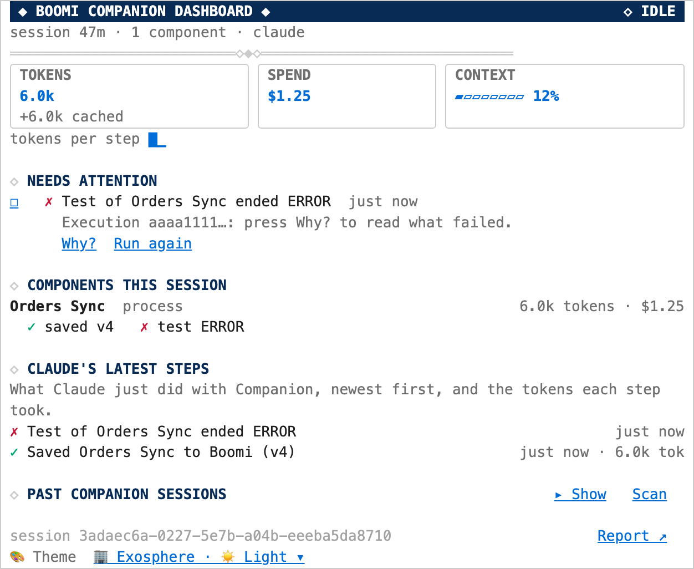
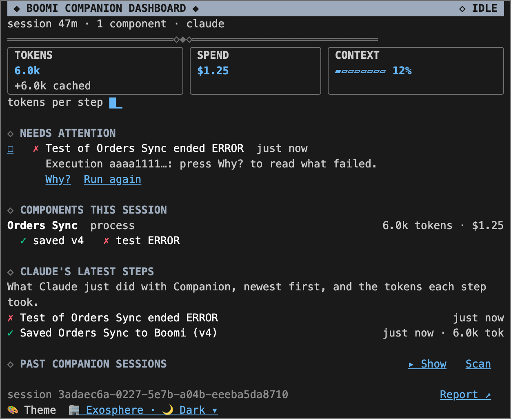
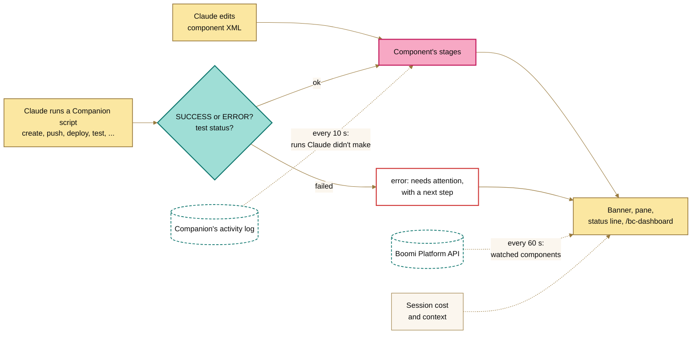

<picture>
  <source media="(prefers-color-scheme: dark)" srcset="assets/banner-night.png">
  
</picture>

# Boomi Companion Dashboard Mod

<div data-flamingo></div>

**Your whole Boomi build at a glance, right next to the conversation.** When Claude builds with [Boomi Companion](https://github.com/OfficialBoomi/bc-integration), the dashboard keeps track of every edit, save, deploy and test. It tells you what broke and what to do about it, and it keeps a running total of what the session is costing you. You never have to leave Claude Code or scroll back through the transcript.

- **See where every component stands.** As Claude works, each component moves through edited, saved (with its version), deployed and tested.
- **Get from a failure to a fix in two clicks.** **Why?** pulls up the log of a failed test or BDI run. **Ask Claude to fix** writes the request for you, log lines included. **Run again** checks the fix without spending a turn of Claude's.
- **Keep an eye on spend.** You get tokens, cost and how full the context is, per step and per component. On a Claude seat it also reads your 5-hour and weekly usage limits and tells you where your current pace is heading. You can set a Companion budget of your own, too: a share of your limit per day, week or month, or a fixed amount per month.
- **Learn from your most expensive sessions.** Look back at a past session to see what made it cost what it did (the model, a long conversation, the same test run over and over) and which Claude Code habit would have saved money.
- **Pick up where you left off.** A new session opens with what the last one did and what it left broken. **Past Companion sessions** shows what earlier work cost.
- **It's not just for integration.** Data Hub deploys, BDI flow runs, Agentstudio agents, custom connector releases and Marketplace recipes all show up as steps. Their failures land under **Needs attention**, and each product gets its own slice of the spend.
- **Catch work done outside the chat.** Companion's activity log adds script runs from a terminal, and watched components let you know when someone else changes them in Boomi.
- **Write better prompts for Boomi work.** Every prompt you type gets checked for the things Boomi work needs and prompts tend to leave out: which component "it" is, the environment, the test data, the error. You get an upgraded prompt right away, built from what the session already knows. A model then polishes it in the background. Anything Claude would have stopped to ask becomes a `[decide: …]` placeholder, with a short note on why it matters. It never gets in your way, except to check with you before a password or token ends up in the transcript.
- **Hand it off.** `/bc-dashboard report` writes the session up in Markdown for a pull request, a ticket or whoever picks it up next. `report html` turns it into a web page with charts that you can send to anyone.

## Install

Paste this prompt into a Claude Code session started from your Boomi Companion workspace (the folder with Companion's `.env`). It works with any Claude account. On Windows, run Claude Code in WSL and paste it there.

```prompt
Install the boomi-dashboard Claude Code mod from https://github.com/brianbrinley/ClaudeMods for my user account, so it loads in every Claude Code session on this computer.

1. Clone the repo (main branch) to ~/ClaudeMods. If it's already there, run `git -C ~/ClaudeMods pull` instead.
2. Check that ~/ClaudeMods/boomi-dashboard/.claude-plugin/plugin.json and ~/ClaudeMods/boomi-dashboard/hooks/register.tsx exist, then run `claude plugin validate ~/ClaudeMods/boomi-dashboard` and `claude plugin test ~/ClaudeMods/boomi-dashboard` and show me the results.
3. Add the mod to the "env" block of my user settings file, ~/.claude/settings.json (not the project's settings):
   "CLAUDE_CODE_PLUGIN_DIRS": "<absolute path to ~/ClaudeMods/boomi-dashboard>"
   Use the absolute path, with my home folder spelled out. If CLAUDE_CODE_PLUGIN_DIRS already has a value, append to it with ":" instead of replacing it. Keep everything else in the file as it is, and show me the diff before you save.
4. Check that Boomi Companion (bc-integration) is installed. If it isn't, tell me how to install it, but don't install it yourself.
5. Run `perl -MJSON::PP -e 'print "ok\n"'`. If it doesn't print ok, tell me the command to install Perl for this system (on Debian or Ubuntu, including WSL: `sudo apt install perl`), but don't run it yourself.
6. Tell me to restart Claude Code. After the restart I'll run /bc-dashboard to check it loaded.

Never read, print or copy my .env or any Boomi credentials. The mod reads them itself.
```

**After the restart,** `/bc-dashboard` should open the pane with nothing under **Needs attention**. Perl is only needed for **Past Companion sessions**, and macOS and Linux already have it.

**Recommended:** turn on Companion's activity log. At the start of a session in a Companion folder the dashboard offers to add `BOOMI_COMPANION_LOG_ACTIVITY=1` to Companion's `.env`, and asks first. Companion's scripts then keep an activity log, which the dashboard reads as a [second source](#companions-activity-log).

### How it's installed, and how to update it

There's no marketplace involved and nothing gets copied. Claude Code loads the mod straight from the folder named in `CLAUDE_CODE_PLUGIN_DIRS`, which is a git checkout of this repository (`~/ClaudeMods`). The checkout *is* the install, so whatever's in it when a session starts is what runs. Any other mods you load from the same checkout, such as boomi-runtime, update along with it.

**To update,** run `/bc-dashboard upgrade`. It does what you'd otherwise do by hand (fetch, pull, validate, test), in this order:

1. **Check.** It runs `git fetch origin` on the checkout's own `origin` remote. That's the only network call it makes. You see the version change, the commits, the changed files, the [changelog](CHANGELOG.md) entries in between, and which mods in the checkout it would update.
2. **Ask.** It asks before installing anything. `--yes` skips this question and nothing else.
3. **Back off rather than risk your work.** If the checkout has uncommitted changes, has commits that aren't on origin, or can't fast-forward, it stops and changes nothing. It never resets, stashes, rebases or force-pushes.
4. **Test before going live.** It checks out the new code in a temporary git worktree and runs `claude plugin validate` and `claude plugin test` there for each mod it would update. If anything fails, nothing gets installed and you see the failing output. Those two commands are the only things it runs from the new code.
5. **Install.** It notes the current commit, fast-forwards the checkout and reads back the new version.
6. **Restart Claude Code.** The running session keeps the code it started with, because the dashboard can't safely reload itself.

| Command | What it does |
|---|---|
| `/bc-dashboard upgrade --check` | A dry run. It checks and changes nothing |
| `/bc-dashboard upgrade` | Check, ask, test, install |
| `/bc-dashboard upgrade --yes` | The same, without asking. The safety steps still run |
| `/bc-dashboard upgrade --rollback` | Goes back to the commit it noted before the last upgrade, as a detached checkout. `main` keeps the newer commits, and the next upgrade returns to it |

Everything it prints has tokens and keys masked (`glc_`, `sk-`, `eyJ`, `Bearer …`, `Basic …`), and it never reads `.env`.

**Update reminders.** When a session starts, the dashboard fetches its checkout to see if you're behind, at most once every `updateCheckHours` (24). The first time it sees a new version, you get one toast: `bc-dashboard X.Y.Z is available`. After that, the pane's footer says `↑ bc-dashboard X.Y.Z is available: /bc-dashboard upgrade` until you install it, and you only get another toast for an even newer release. It never installs anything on its own, and it stays quiet when you're offline. You can turn it off with `updateCheck` under `/config`.

To do it all by hand: `git -C ~/ClaudeMods pull --ff-only`, then `claude plugin validate` and `claude plugin test` on the mod, then restart.

## What you see

`/bc-dashboard` opens the pane, and Esc closes it. Where a pane can't be shown, including Claude Code on the web, you get the same thing as text.

**Resizing it:** drag the pane's edge, and Claude Code remembers the size. To set a size up front, use `/bc-dashboard size <rows> [columns]`, or `size` on its own to go back to the default. That saves the `paneRows` and `paneColumns` settings, which you'll also find in `/config` and `/bc-dashboard config pane`. Rows set its height above the prompt. Columns set its width when it's docked beside a fullscreen transcript.

 

- **Gauges** for tokens, spend and how full the context is, with the last step's share of each.
- **Needs attention** lists what's still broken, each with a next step.
- **Components this session** shows each component's stages, tokens and cost.
- **Claude's latest steps** is what Claude just did with Companion. **More** shows older ones.
- **Guardrails** shows the runtime's state and smoke test, when [boomi-runtime](../boomi-runtime/README.md) is loaded.
- **Past Companion sessions** is what earlier sessions on this machine did and what they cost. **More** pages through them.
- **Watched components** are the ones you asked to watch, and who last changed them in Boomi.
- **Themes.** The default, **Auto**, uses Boomi's [Exosphere](https://exosphere.boomi.com/) look in whichever of light or dark your system uses. You can also pick **Exosphere light**, **Exosphere dark**, **Whimsical light**, **Whimsical dark** (the Valence Miami Deco look, flamingo and all) or **Terminal** (your terminal's own colors). Choose from the picker at the bottom of the pane, or with `/bc-dashboard theme whimsical-dark`. In Exosphere the mark is the Boomi logo, drawn as a picture in terminals that can (kitty and Ghostty) and left out in the rest. In Whimsical it's the flamingo. Your choice is saved as the `paneTheme` setting, so it shows up in `/config` too. If you used `day` or `night` in an earlier version, those now mean Whimsical light and dark, and a banner icon of `flamingo` keeps Auto in Whimsical. Auto follows macOS's light or dark setting. Where it can't tell (Linux, Windows, a locked-down shell) it uses light, and picking a theme with the buttons sticks.

A banner above the prompt shows the latest step and what needs attention, and the status line and toasts keep you posted too. In a new session, until Companion does something, the status line says so (`New session · last one 14h ago, nothing left to fix · $0.00 this session`) instead of repeating the last session's step:

```text
◆ BC Dashboard ✓ Saved Orders Sync to Boomi (v4) 2m ago │ ✗ 1 needs attention │ 3 components │ 338k tokens · $0.54   [ Open ]  [ Hide ]
```

**A new session** in a Companion workspace starts with a recap of the last session in that folder. Until Companion does something, it then cycles through a tip every 20 seconds:

```text
◆ BC Dashboard ✓ Last session 14h ago: 4 components · 6 saves · 2 deploys · 3 tests (1 failed) · nothing left to fix · $3.10 │ $0.00 this session   [ Open ]  [ Hide ]
◆ BC Dashboard Tip: Why? on a failed test reads its log; Ask Claude to fix drafts the request │ $0.00 this session   [ Open ]  [ Hide ]
```

If Claude Code can tell which Companion plugins are turned on, the first tip lists them, and you won't see tips for plugins you don't have:

```text
◆ BC Dashboard Companion here: Integration 1.0.83 · Data Hub 0.2.12 │ $0.00 this session   [ Open ]  [ Hide ]
```

Anything the last session left broken stays under **Needs attention**, and the banner counts it. Outside a Companion workspace (no component folder, activity log or earlier session in that folder), the banner stays out of the way.

## Stages and what needs attention

| Stage | Means |
|---|---|
| ◐ edited, not in Boomi yet | Claude changed the XML, but Companion hasn't created it in Boomi yet. |
| ◐ edited since last save | Claude changed the XML after Companion last pushed it. |
| ✓ saved v4 | Companion pushed it, and Boomi has version 4. |
| ✓ deployed / ◐ redeploy needed | It's deployed, or it was saved again since, so the environment is running an older version. |
| ✓ test passed / ✗ test ERROR | How the latest test execution went. |
| ⚠ save blocked | Another mod refused the push. |
| ✗ save failed, ✗ deploy failed | Companion's script reported an error. |

Icons always come with a label: ✓ done, ◐ in progress or still to do, ⚠ blocked or unreachable, ✗ failed. A later success clears an earlier failure.

Each item under **Needs attention** has buttons:

- **☐** closes it, for a failure you expected or dealt with some other way. Closed items stay closed after a restart, and **Reopen** brings them back.
- **Why?** on a failed test runs Companion's `boomi-execution-query.sh --logs` and shows the log's `SEVERE` lines. **Ask Claude to fix** then puts a fix request with those lines into the prompt box, after whatever you've already typed. Nothing is sent until you press Enter.
- **Why?** on a failed BDI run follows bc-bdi's own troubleshooting guide. It shows the reason BDI gave. For a logic flow, it also shows the first step that failed (`bdi-flow.sh steps`). Then come the run log's `ERROR` lines, in the order they happened (`bdi-flow.sh logs`). Neither read changes the flow. **Ask Claude to fix** drafts a request to find the cause and suggest a fix, and to leave the flow alone until you approve.
- **Run again** on a failed test that Claude ran repeats the same `boomi-test-execute.sh` call without a turn of Claude's. If it passes, the failure clears.

Without a pane, use `/bc-dashboard close <n>`, `why` and `rerun`. If nothing fits, `why` and `rerun` tell you. If there's one failure, they act on it. If there are several, they ask which one in Claude Code's question dialog, showing the four newest, and **Other** takes a number. A number from `/bc-dashboard text` skips the question.

When Claude ends a turn with a process saved but not deployed, or deployed but not tested, the prompt box suggests what's next ("Deploy Orders Sync and test it"). Press Tab to take it.

## Companion's other plugins

Boomi Companion is made up of [six plugins](https://github.com/OfficialBoomi/boomi-companion). Alongside bc-integration's components, the dashboard follows the other five through their scripts, the same way:

| Plugin | Steps it shows |
|---|---|
| bc-marketplace | Recipes installed (`Marketplace: installed recipe Salesforce to NetSuite Orders · 4 components`) and their supporting materials downloaded. The components a recipe copied join **Components this session** as `✓ from recipe …`. Pull one, and its name and later stages fill in on the same row |
| bc-datahub | Models created, updated, published and given quality steps; sources and their initial loads; universes deployed; quarantined records approved or rejected; golden records updated, end-dated or restored. A deploy shows `◐ deploying` until its response, or Claude's `datahub-deployment.sh status`, says how it went. A failed deploy needs attention. When Claude lists a universe's quarantine (`datahub-quarantine.sh query --universe <id>`), a **Data Hub** section keeps the count and the causes. Records in quarantine need attention, and an empty list clears it |
| bc-bdi | Flows run, cancelled, activated, created or restored; CDC turned on or off; connections, environments, variables and dataframes changed. A run shows `◐ run started` until Claude checks it with `bdi-flow.sh status`. Then it shows how the run ended: ✓ succeeded, cancelled, or ✗ failed, with BDI's reason under **Needs attention** |
| bc-agentstudio | Agents, tools and MCP servers created or updated; agents packaged and deployed; test conversations with a deployed agent. An **Agentstudio agents** section shows each agent's stages, the way components have them: `✓ created  ✓ packaged v2  ✓ deployed  ✓ 2 test conversations, 5 turns, all answered`. An edit after packaging shows `◐ changed since packaged` until a new package is deployed. A conversation is matched to its agent through the deployment it talked to. A turn that fails (an HTTP error, a stream's `event: error`, or a reply that says `success: false`) needs attention |
| bc-connectordev | Connector projects created and checked; descriptors linted and validated; versions uploaded; groups and version changes. A **Custom connectors** section follows each connector's release by its project folder and group: `✓ descriptor linted  ✓ validated  ✓ uploaded v2  ✓ v2 active on dev`. An upload shows `◐ v2 not active yet` until a version change makes it active. A change to a PUBLIC connector shows `◐ awaiting approval`. A failed lint names the line and element. A descriptor that's validated with warnings, or rejected, needs attention |

**You only see the sections that apply.** Right after a session starts, the dashboard asks Claude Code which plugins are turned on in that folder (`claude plugin list --json`, which knows about user, project and synced installs, and about disabled plugins). If it can't run the CLI, it reads Claude Code's own `plugins/installed_plugins.json` and settings instead. Then:

- **Components this session** only shows where bc-integration or bc-marketplace is turned on.
- **Data Hub**, **Agentstudio agents** and **Custom connectors** show up for an installed plugin even while they're empty, with a line saying what will go there.
- A section with something in it always shows, installed or not. If the plugin list can't be read at all, every section shows, as it did before 0.24.0.

A few more things hold for all five:

- Steps that only read (`list`, `get`, `query`, `status`, `logs` and so on) aren't shown, just as bc-integration's searches aren't.
- A failed step (an `ERROR:` line, or the script exiting with an error) goes under **Needs attention** with its error line, until the same action succeeds. A step that finishes with a `WARNING:` line, such as a connector descriptor accepted with warnings, shows as ◐ and needs attention too.
- When a session works on more than one product, the pane, `/bc-dashboard text` and the report break down the spend: `By product: Integration $1.20 · Data Hub $0.40`. The report gives the other plugins' steps a section of their own.
- **Past Companion sessions** counts any session that used any of the plugins, and says what it did with them (`2 Data Hub steps · 1 BDI step`).

The wording is based on the plugins' scripts as of October 2026 (bc-marketplace 0.2.10, bc-datahub 0.2.12, bc-bdi 0.2.5, bc-agentstudio 0.1.42, bc-connectordev 0.0.50), and the tests use those scripts' own `SUCCESS:`, `ERROR:` and `WARNING:` lines. Each plugin's live output still needs checking in a real session. See the [CHECKLIST](../CHECKLIST.md).

## Tokens and spend

The headline number counts **new tokens**: input, output and cache writes. **Cache reads**, which is the conversation being re-read on every call, are shown separately (`+3.3M cached`). They're billed at a fraction of the price, and if they were counted in, they'd dwarf the actual work. `/bc-dashboard text` breaks the session down by kind, and by model if more than one was used:

```text
Tokens: 412k new (18k in · 44k out · 350k cache writes) · 3.30M cache reads
```

Spend is the session's cost as `/cost` reports it. On a Claude seat, that's what the same usage would cost on the API, not what you're billed. A step's share is what Claude spent since the step before it, and a component's is the total of all its steps.

**Budget:** if you set `budgetUsd`, the status line, the summary and the SPEND gauge warn you from 80% (`◐ 84% of the $5.00 budget`) and again once it's spent, with one toast at each point. Out of the box that's all it does, and nothing gets stopped. To make a spent budget actually pause or stop Companion's changes, see [Budget enforcement](#budget-enforcement).

### Your Claude usage limits

On a Claude seat (Pro, Max, Team or Enterprise), the dashboard reads your usage limits as Claude Code reports them, with no setup: the 5-hour and weekly windows, plus your admin's spend limit if there is one.

- **LIMITS** in the pane shows the busiest window, when it resets, and where your current pace takes you. That's `◐ used up in 1d 6h` if you'd run out before the reset, and `on pace for 64% by reset` otherwise.
- The banner fits them into a few characters (`week 42% · 5h 12%`). The status line, `/bc-dashboard text` and the report go into more detail.
- You get a toast at 80% of a window and another when it's used up, once per window.

With an API key there are no limits to read, so none of this shows.

**Your monthly Claude budget, in dollars.** The same headless `/usage` run also reports the account's monthly budget and how much of it is used (the figure the interactive `/usage` shows). So with no setting at all, BUDGET shows `Claude budget: $380 of $1100 this month`. That's the account's own number, including other devices and claude.ai. It warns at 80% and again when it's used up, it counts for `budgetEnforce`, and it needs extra usage turned on for the account. Claude Code doesn't document this field, so if it ever changes, the line goes quiet instead of guessing. If your login only reports a spend limit as a percent, `seatBudgetUsd` (or **Your Claude budget** in `/bc-dashboard config budget`) turns that percent into dollars.

**When it resets, and where the month is heading.** The budget resets at 00:00 UTC on the 1st. For a login on Eastern time, that's Oct 31 at 8:00 PM EDT, and Claude Code and Claude Desktop say the same. Claude Code doesn't keep a history, so the dashboard saves the last reading of each day. Under the budget it then shows `Claude pace: on pace for $811 (74%) by the reset in 15d 4h`, which is the month's average so far carried forward to the reset. If that pace would go over the limit, it says `at $61/day it's used up in 3d 0h, before the reset in 16d 4h` instead. It also shows `Claude spend: $30 today · $26/day this month`. The pace waits until a tenth of the month has gone by, so the first few days don't throw out wild projections. These are readings and estimates. They never count as a spent budget, and they show up in the pane, `/bc-dashboard text` and both reports. If your billing cycle doesn't start on the 1st (UTC), they'll be off, though the budget itself will still be right.

**How much of your usage is Companion.** Every 15 minutes the dashboard runs `claude -p "/usage" --output-format stream-json --verbose --no-session-persistence --safe-mode`. That makes no model call, keeps no session, loads none of your hooks or plugins, and costs nothing. All the sessions on this machine share one reading. From Claude Code's own breakdown, it shows `Companion: ≥20% of your usage today · ≥18% this week`. That's the `bc-*` plugins added up, and it's a lower bound, because only the top plugins are listed. It also names the habit behind most of the week's usage, such as `44% of your usage was at >150k context`. This is Claude Code's estimate from this machine's sessions, not claude.ai or your other devices. Without a subscription the command has no breakdown, so nothing shows. `usageBreakdown` turns it off.

### Your own Companion budget

Two optional settings under `/config` give Companion work a budget of its own. Both warn in the status line from 80%, with a toast at 80% and at 100%. With `budgetEnforce` left at its default (`warn`), they don't stop anything. With `confirm` or `block`, a spent budget really does stop Companion's changes. See [Budget enforcement](#budget-enforcement).

**BUDGET** in the pane shows every budget you've set, `budgetUsd` included. The fullest one gets the meter, and each gets a line, such as `✓ month: $32.10 of $50`, `◐ share, today: 84% of 30%` or `✓ session: $1.25 of $5.00`. If you haven't set a budget, it doesn't show.

- **A share, with `companionShare`:** the percent of your weekly limit that Companion is allowed to use over `companionSharePeriod`. That's `week` (the last 7 days), `day` (today, a seventh of the share) or `month` (this month, the month's days in sevenths). At 30% per day, Companion gets 4.3% of your weekly limit each day: `Companion today: 2.1% of your weekly limit, 49% of its 4.3%`. From a session's first Companion step, the dashboard tracks how far the weekly limit climbs each day, and adds up the Companion sessions on this machine.
- **An amount, with `companionMonthlyUsd`:** a dollar amount for this calendar month's Companion sessions, measured in Claude Code's own cost figures. That's the earlier sessions from **Past Companion sessions** (scanned for you about once an hour), plus this one as it happens.

Your limit is shared, so during a Companion session, anything else using Claude at the same time counts too, on this machine or another one. Sessions on other machines, and Claude Code on the web, don't get added up.

### Set up a budget

There are three budgets. You can set any of them, or none. By default they only warn. If you set `budgetEnforce` to `confirm` or `block`, any one of them running out will pause or stop Companion's changes, as the next section explains.

| You want to cap | Setting | Works on | Example |
|---|---|---|---|
| This one session's cost | `budgetUsd` | a seat or an API key | `5` warns at $4.00 and $5.00 |
| Companion's share of your weekly Claude limit | `companionShare` and `companionSharePeriod` | a Claude login that reports a weekly limit; otherwise the share shows as not measured | `30` and `day`: about 4.3% of the weekly limit each day |
| Companion's cost this calendar month, across all sessions on this computer | `companionMonthlyUsd` | a seat or an API key | `50` warns at $40 and $50 |

Not sure where to start? On a Pro or Max seat, try `companionShare`, since your limit is what runs out. On an API key, try `companionMonthlyUsd`, since your bill is what grows.

**With the dashboard (easiest):** run `/bc-dashboard config budget`. It walks through each budget in turn, starting from your current value, and suggests figures based on what your past Companion sessions cost, such as "twice a typical session" or "a quarter above the last 30 days". Pick one, keep what you have, or type your own under **Other**. Your changes are saved to `/config` and take effect right away.

**In `/config`:**

1. Run `/config`.
2. Find the **boomi-dashboard** rows: **Spend budget (USD)**, **Companion's share of your usage limit (%)**, **Companion share period** and **Companion's monthly amount (USD)**.
3. Type a number (without `$` or `%`), or pick the period. `0` turns a budget off.
4. The dashboard reloads with the new values. If **BUDGET** doesn't appear in the pane within a minute, restart Claude Code.

**In the settings file:** the same values live in your user settings, `~/.claude/settings.json`, under `pluginConfigs`. Add or change just this block and leave the rest of the file alone:

```json
{
  "pluginConfigs": {
    "boomi-dashboard": {
      "options": {
        "budgetUsd": 5,
        "companionShare": 30,
        "companionSharePeriod": "day",
        "companionMonthlyUsd": 50
      }
    }
  }
}
```

Numbers go in without quotes. The period is `"day"`, `"week"` or `"month"`. Leave out any budget you don't want, or set it to `0`. Then restart Claude Code.

**To check it worked:**

- The pane shows a **BUDGET** gauge with a line for each budget you set, such as `✓ session: $1.25 of $5.00` or `◐ share, today: 84% of 30%`.
- `/bc-dashboard text` prints the same lines.
- If there's no **BUDGET** gauge, either no budget is set or the value isn't a number. Open `/config` again and take a look.

**When it warns:** at 80%, the status line shows `◐` and the percent, and you get one toast. At 100% it shows `✗` and you get a second toast. Each toast only appears once, not on every refresh. To keep working past a budget, raise it or set it to `0`.

### Budget enforcement

> **Once you turn this on, it really does block things.** With `budgetEnforce` set to `confirm` or `block`, the dashboard stops Claude's Boomi Companion changes once a budget is spent. The command never runs, so neither Companion nor Boomi ever sees it. It's off by default (`warn`).

`budgetEnforce` decides what happens when a budget is spent:

| `budgetEnforce` | Once any budget you set reaches 100% (plus `budgetGrace`) |
|---|---|
| `warn` (default) | It warns, as described above. Nothing is stopped. |
| `confirm` | Before each Companion change, it asks you: **Allow this one**, **Allow for the rest of this session**, **Raise the budget** (opens `/bc-dashboard config budget`, then lets the change through if the budget is no longer spent) or **Stop**. Closing the question counts as Stop. |
| `block` | It refuses every Companion change outright. |

**What counts as a Companion change:** creating, saving (pushing), deploying, undeploying and test-running a component. bc-integration's other scripts that change things count too: creating a folder, creating or deleting a branch, setting extensions, calling a deployed web service, creating Event Streams topics, subscriptions, tokens or connections, and sending a message to a topic. So do the other plugins' subcommands that change something, which are the same ones the dashboard counts as steps. Two more things are gated:
- A call straight to the Platform API that changes something: PUT, PATCH, DELETE, or a POST that isn't a query, sent to `api.boomi.com` with curl, wget or HTTPie.
- A local script that Claude runs (`bash run-all.sh`) that contains any of the above. The dashboard reads the script first.

**What's never stopped:** reads (list, get, query, status, logs, pull, search, and the Platform API's GETs and `…/query` POSTs); checks and scaffolding on your own machine (a connector's descriptor lint, doctor, init and validate); downloads (a Marketplace bundle's supporting materials); cancelling a BDI run, since that only stops spending; and the dashboard's own tools, including **Why?** and **Run again** when you press them in the pane. A change that's already running when the budget runs out always gets to finish.

**`budgetGrace`** (a percent, `0` by default) lets work run a little past a budget before enforcement kicks in. `10` means it starts at 110%.

**What you see:**
- A refused change shows as `⚠ Blocked by budget` in Claude's latest steps and under **Needs attention**, naming the budget and how far over it is.
- The status line and the banner say `⛔ budget reached, Companion changes paused`, and you get one toast when it starts.
- Every override you allow in `confirm` mode is recorded as a step. It's listed under **Budget overrides** in `/bc-dashboard report` and the HTML report, and shown next to the change it let through under **Platform changes**, so you have an audit trail.

**What Claude is told:** with your next prompt after enforcement starts (and again whenever it changes), Claude gets a short note saying the budget is spent and changes are paused, so it can plan around that. The note costs about 80 tokens each time. When a call is refused, Claude is told which budget is spent and by how much, and asked to stop and tell you, not to find a way around the block (no curl to the API, no running the script some other way).

**Limits:** the gate only reads the commands Claude runs through the Bash tool. It can't see changes made any other way, such as a script that builds its command at run time, a program in another language, or work you do yourself in a terminal. The refusal message tells Claude not to try.

**To set it up,** run `/bc-dashboard config budget` and answer the **When a budget is spent** and **Grace past a budget** questions, or set `budgetEnforce` and `budgetGrace` in `/config`.

## Prompt tips

In a Companion folder, the dashboard checks each prompt you type for things Boomi work needs that the prompt leaves out, and suggests a better version. The checks are plain rules with no model call, so they're free. The upgrade starts out the same way, from rules. Then a model (`promptModel`, haiku by default) rewrites it in the background, which costs a few cents at most per prompt. `promptRewrite manual` turns that part off.

| Check | Fires on | The tip names |
|---|---|---|
| `subject` | "it", "this" or "the process" with no component named | The component Claude worked on last |
| `environment` | A deploy with no environment | The environment Companion's `.env` points at |
| `error` | "Fix it" or "still failing" with no error, log or execution ID | The last failure and its execution ID |
| `test` | A test with no test data or expected result | What to add |
| `production` | "prod", "production", "live orders", "customer data" | That Claude should ask first (⚠) |
| `build` | A new process with no source and target, trigger or data format | What's missing |
| `map` | A map with no profiles or fields | What to add |
| `steps` | Three or more big steps at once (build, deploy, test, fix) | That Claude should stop between them |
| `aim` | Poking around the account with nothing specific to find ("check out my account") | What to ask for. It's only a nudge: `confirm` won't hold a prompt for this alone |
| `secret` | A password, token, API key, auth header or private key | That it will be masked (⚠) |

For example, after a failed test of Orders Sync, `deploy it and test it, still failing` gets:

```
◐ "it": the process Orders Sync, the last one this session?
◐ deploy: no environment named; the session points at 9f8e7d6c…
◐ fix: no error given; the last failure was the test of Orders Sync (execution-aaaa1111)
◐ test: say what to test with, and what a pass looks like

Upgraded:
  deploy it and test it, still failing. By "it" I mean the process Orders Sync (1a2b3c4d-…).
  Deploy to environment 9f8e7d6c-…. The last failure was the test of Orders Sync
  (execution execution-aaaa1111): …. Read its process log and tell me the cause before
  you change anything.

  Details:
  - Test data: [what to test with]; a pass means [the expected result]
```

The upgrade only adds what the session actually knows, written as sentences. Anything it doesn't know goes in a **Details** list of `[placeholders]` for you to fill in. It never makes up a name or an ID.

**What you see:** a gentle nudge in the banner just above the prompt box, `◆ BC Dashboard ◐ Boomi Dashboard suggests a clearer prompt · 4 tips`, with **Use it** (puts the upgrade in the prompt box), **See it** (opens the Prompt tab) and **✕**. It goes away when you send your next prompt. The status line says `◐ 4 prompt tips: /bc-dashboard prompt`, and `/bc-dashboard prompt` shows the tips and the upgrade, on the web too.

**The Prompt tab.** **See it**, or a prompt with tips, opens **Boomi Dashboard Prompt tips** where the dashboard pane usually sits. Claude Code can't bring a tab to the front, so the dashboard pane steps aside, and it comes back when you press **◀ Dashboard** or **Dismiss**, or send a prompt with nothing to add. The tab shows the tips, then your prompt beside the upgrade (stacked in a narrow pane), with the buttons right below:

- **Use the upgrade** puts it in the prompt box, **Copy** copies it, and **Dismiss** closes the tab.
- A long prompt or upgrade is trimmed to fit the pane so the buttons stay in view, with `▼ 14 more lines` and **Show all**, then **Jump to the buttons** and **Fit to the pane**.
- **The model's rewrite** shows up on its own a moment after the tips (`promptRewrite auto`, the default). While it's working, the upgrade card says `HAIKU IS WRITING A BETTER ONE…` with a spinner, and the pane's prompt-tips row says `upgrading it…`. The quick version stays put until the new one lands. It arrives as the next try, with a **Why it changed** note underneath: up to three lines on what it added or asked, and why that matters for Boomi work. **Upgrade with a model**, and after that **Regenerate**, asks for another. With `promptRewrite manual`, it only runs when you press the button or run `/bc-dashboard prompt upgrade`. You can type a note under the buttons (`shorter`, `ask for a listener`, `split into steps`) and press Enter to regenerate with it in mind. Long notes wrap in the field. Every try is kept, and **◀** and **▶** step through them, each with the note it followed.

**What a rewrite reads,** besides your masked prompt and the session's facts:
- **Components in this folder** whose names share words with the prompt (up to 8, from the component XML under `componentsDir`). That way "the Salesforce connection" can name the one you actually have. It only uses a name where the prompt clearly means it.
- **Companion's own guidance,** meaning every reference doc of every Companion plugin you have installed: bc-integration's `guides/`, `steps/`, `components/` and `platform_entities/`, plus `BOOMI_THINKING.md`, and the other plugins' own docs. It reads the sections that best match the prompt's words straight from the docs, with headings and file names counting most. That's up to 6 sections, each trimmed to its best paragraphs (2,000 characters at most), and 10,000 characters in all. This is how the rewrite knows what Companion needs for a listener, a map or a connection.
- **Your note** and **the previous try**, so each regenerate comes out different.

The rewrite polishes your wording and fills in what's vague from the session. Things Claude would have stopped to ask about (the environment for a deploy, the source and target of a new process, what counts as a passing test) become placeholders like `[decide: which environment - Dev?]`, with a suggested default only where the session or Companion's guidance backs one up. It's told never to add features, steps or logic you didn't ask for. That's an instruction to a model, not a guarantee, so read the rewrite before you send it: it can still add a step of its own, such as asking Claude to stop and show you the cause before changing anything. The components and guidance only decide which existing names fit and what to ask you, and a gap always becomes a question, never a decision made on your behalf. It never fills the prompt box by itself, and a prompt whose only tip is a secret never goes to a model. It only reads the facts a tip needs. For example, it reads the last failure only for a fix.

The tab tells you how much of each it read, and which Companion plugins and versions that came from. It's a plain word match, with no embeddings to set up. To keep it fast, the dashboard keeps an **index of pointers** to Companion's docs (each doc's fingerprint, its section headings and their key words, never Companion's actual text), saved between sessions. The index is rebuilt when a Companion plugin's version changes, and even then each doc is only re-read to check whether it changed. A weekly Companion upgrade gets picked up on its own, and nothing is read again in between.

**The guide, and Companion upgrades.** What Claude should ask before each kind of work comes from the dashboard's own guide (`hooks/prompt-guide.ts`). It's organized by Companion plugin and stamped with the version it was written for. When Companion moves on, the Prompt tab tells you (`The dashboard's guide was written for bc-integration 1.0.83 (now 1.0.90)`). `/bc-dashboard prompt guide` shows where each plugin stands and the changelog lines since the guide's version. `/bc-dashboard prompt guide refresh` has the model draft edits for each plugin that's moved on or has no lines yet, each pointing to the changelog line or doc heading behind it. It prints the draft and changes nothing. You read it, edit the guide and update its stamp. A rewrite reads a few thousand tokens in a separate call, so it adds nothing to your session's context. Only the prompt you send does.

The dashboard pane shows `◐ 4 prompt tips for your last prompt` with a **Prompt tips** button. `promptView` decides when the tab opens on its own: `auto` (the default) when a prompt gets tips, `manual` only when you ask, `off` never.

- `/bc-dashboard prompt use` puts the upgrade in the prompt box.
- `/bc-dashboard prompt upgrade [a note]` has the model rewrite it, following your note, and puts that in the prompt box.

**`promptCheck`** decides what a tip does:

| `promptCheck` | A prompt with tips |
|---|---|
| `confirm` (default) | **Holds it,** so Claude doesn't see it yet. The Prompt tab and the banner say `⏸ Held`, with **Send the upgrade**, **Send as typed**, **Edit in the prompt box** and **Discard**, and the status line says `⏸ prompt held`. A new prompt replaces a held one. Where the tab can't show (the web, a narrow window), you get a question instead, and closing it sends the prompt as typed. |
| `suggest` | Goes to Claude as typed. The tips show afterwards, with the nudge above the prompt box. |
| `off` | Nothing is checked. |

**A secret always gets a question, even in `suggest`,** because once it's sent, it stays in the transcript. You can **Send it with the secret masked**, **Edit it first** or **Send it as typed**. Closing the question sends it masked.

**What's left alone:** slash commands, prompts you type while Claude is working, messages from other sessions and background tasks, short replies ("yes", "keep going"), prompts without any Boomi words in them, and anything outside a Companion folder. Start a prompt with `>` to send it unchecked (the `>` gets removed).

**Closing out.** Ending the session is never held, tipped or rewritten. `/exit`, `/quit`, `/clear` and `/handoff` go straight through, and they let go of a prompt the dashboard was holding. So does a wrap-up in your own words, such as "write a handoff for the Orders Sync process" or "wrap it up", even though it names a process. A secret in one still asks first.

**Suggestions you take.** Sometimes the prompt box shows a dim suggestion, either Claude's own guess after a turn or the dashboard's next step. If you take it with Tab and send it as it is, it isn't your wording, so it isn't checked: no tips, no hold, no rewrite and no model call. If you edit a suggestion, it's checked like any other prompt, and a secret in one still gets a question. Each suggestion only counts once. The count shows in `/bc-dashboard prompt` and the session report (`2 of Claude's suggestions taken as they were`). `promptSuggested check` treats them like any other prompt. Claude Code doesn't say where a prompt came from, so the dashboard recognizes a taken suggestion by matching the words.

**Privacy:** your prompt is masked before it's kept, it's only kept in this session's state, and it's never logged or saved across sessions. A held prompt is kept as typed, in this session only, until you send or discard it. The model rewrite reads the masked prompt, the session's facts, matching component names and Companion's docs. It never reads Companion's `.env` or its token. The dashboard only reads `BOOMI_ENVIRONMENT_ID` from it, for the tips.

**What gets counted:** `/bc-dashboard prompt` and the session report tell you how many prompts were checked and had tips, how many tips your next prompt followed, and which tip came up most.

**To skip a check,** list it in `promptSkip`, for example `promptSkip test,steps`.

## Watched components

`/bc-dashboard watch <component ID or XML file>` keeps an eye on a component across sessions. Every 60 seconds the dashboard reads (never writes) its version in Boomi. If anyone other than Companion's API user changes it, it shows up under **Needs attention** as a reminder to pull before you push. `/bc-dashboard seen` clears changes you were expecting. If nothing is being watched, the dashboard makes no Platform API calls at all.

Credentials come from Companion's `.env`, or failing that, from environment variables: `BOOMI_API_URL`, `BOOMI_USERNAME`, `BOOMI_API_TOKEN`, `BOOMI_ACCOUNT_ID`. The token only ever goes into a request's `Authorization` header. The dashboard never stores, shows or logs it, and its error messages only include the HTTP status. Without credentials, everything else still works.

**The production check** (`envCheck`, off by default) is the one other read of the `.env`'s environment: at the start of a session it asks Boomi for the environment list, and keeps only the environment's name, ID and classification. With `enforce`, a Companion deploy, undeploy or test run to an environment that isn't TEST or DEV is refused before it runs, and so is one to an environment the list doesn't show. A command that runs a `.sh` or `.bash` script of its own (a deploy wrapper or a local helper, not Companion's) is refused too, since the check can't see what that script does. Run Companion's scripts directly, or turn the check off for that work. The refusal says why and tells Claude to stop and tell you. A push is never refused by this check.

**This is a best-effort guard, not a sandbox.** It doesn't see a script in another language (Python, Node, Perl), an executable without an extension, `bash -c` or `eval`, a `.env` named through quotes, globs or variables, or a write made by a tool the check doesn't recognize. Any of those can run a Boomi change that the check never sees. Keep the production check as one layer. The control that holds regardless of the shell is a Boomi-side role for the AI user with no deploy rights in production, which is still to be built.

Up to 0.10.0 the dashboard also checked the environment's process runs. That's been set aside for now and will be back; see [IDEAS](../IDEAS.md#dashboard-follow-ups).

## Companion's activity log

**Turning it on.** At the start of each session in a Companion folder, until you answer, the dashboard asks whether to add `BOOMI_COMPANION_LOG_ACTIVITY=1` to Companion's `.env`: **Yes, add it**, **Not now** (it asks again next session) or **Never ask again**. While the log is off the pane says so, with **Turn it on** and **Don't ask** buttons. `/bc-dashboard activity-log` does the same by command: `on`, `off` (asks first), `status` and `never`.

The dashboard does the write itself, so `.env` never goes through Claude or into the conversation. It adds that one line and changes nothing else, or removes only that line, keeps your line endings, and reads the file back to check. It reads `.env` for that one key and never shows or keeps anything else in it. Companion reads `.env` each time a script runs, so the log starts with the next script and needs no restart. Only the value `1` turns it on; `true` doesn't.

If the write is refused, the dashboard shows the exact line and the file to put it in, with a one-line `echo` for a terminal. Set `activityLogPrompt` to `never` under `/config` to stop the offer.

If `BOOMI_COMPANION_LOG_ACTIVITY=1` is in Companion's `.env`, its scripts write each operation to `.activity-log/activity.jsonl` in the workspace, on this machine only. While that file is changing, the dashboard reads it every 10 seconds and adds anything Claude's tool calls didn't show, such as a script run from a terminal, run by another tool, or run before the mod loaded. Those steps are marked **log** in the pane and "from Companion's log" in `/bc-dashboard text`.

- Creates, pushes, pulls, deploys, undeploys and tests become steps, with the same stages and **Needs attention** items as Claude's own. Searches, folder listings and the like are left out.
- A script Claude ran shows up in both places, but its log entry is matched to the step from Claude's tool call, so you only see it once.
- Only the last 24 hours (`recentHours`) count. If the log is over 3.5 MB, it's read from the end.
- `activityLog` under `/config` turns it off.

## Past Companion sessions

In the pane, this section starts folded down to its totals and a count, so the current session gets the room. **▸ Show** lists the sessions and **▾ Hide** folds them back up, and the dashboard remembers your choice for later sessions.

**Scan** in the pane, `/bc-dashboard history` or the `history` tool lists every session on this machine from the last `historyDays` days that ran a Companion script. For each one you see when it started, how long it ran, what it cost, what it was about (its title if you named it with `/rename`, otherwise your first request) and what it did:

```text
Boomi Companion sessions on this machine, last 90 days:
  This week: 3 sessions · $18.40 · 1.2M tokens
  Last 30 days: 9 sessions · $61.75 (+1 without a recorded cost) · 4.1M tokens

  Oct 10, 14:05 · 47m · $6.10 · "Build the orders sync process and test it"
      2 pushes · 1 deploy · 2 tests · Orders Sync, Order Profile · 410k tokens
```

- The cost is Claude Code's own figure, as `/cost` showed it, read from the transcript. Older Claude Code versions didn't record it, so those sessions only show tokens.
- A session only counts if it actually ran a Companion script, not if it just looked at one. The folder only appears on each line when the sessions come from different folders.
- **Review one.** **Review** next to a session shows what drove its cost, read from the transcript's numbers, with a suggestion for next time on each. It flags things like the largest model doing most of the work (`/model`), a long conversation re-read on every call (`/clear`), a context that grew very large (`/compact`), a session that kept compacting, the same test or push run again and again, and subagents doing a lot of it. **Ask Claude to review** puts a request for a closer look into the prompt box, naming the transcript. Nothing is sent until you press Enter, and that closer look costs a turn. `/bc-dashboard review [n]` gives you the same thing as text. Without a number, it asks which of the four most expensive sessions from the last 30 days you mean.
- **Reopen one.** **Copy** next to a session puts the command that reopens it on your clipboard, `cd <its folder> && claude --resume <session ID>`, ready to paste into a new terminal. `/bc-dashboard resume` does the same from the prompt. If there are several sessions it asks which one, and `resume <n>` takes the nth newest. Where the clipboard isn't available, it shows you the command to type instead.
- Transcripts are often tens of MB, which is more than the 4 MiB a mod can read at once. So `scripts/scan-sessions.pl` reads them a line at a time and only returns each session's totals and the commands that mention a Companion script. It needs Perl, which macOS and Linux already have. **On Windows, run Claude Code in WSL.**

## Session report

`/bc-dashboard report` prints the session as Markdown, ready for a pull request, a ticket or a hand-off. It covers components, deployments and tests, what needs attention, the platform changes, runs and spend. `report save` also writes it to `boomi-session-report-<date>.md`. Claude can ask for it too, with the `report` tool.

### As a web page to share

`/bc-dashboard report html` saves the report as a single file in the workspace and opens it in your browser. There's also a small **Report ↗** button in the pane's footer, to the right of the session ID, that does the same thing. You can send the file to anyone, including people who don't use Claude Code. Nothing in it is live. It's a snapshot with no credentials, and anything that looks like a token is masked.

- **This session, or all of them.** If the dashboard has steps from earlier sessions in this folder, it asks which you want. **This session** saves `boomi-session-report-<time>.html`. **All sessions in this folder** saves `boomi-sessions-report-<time>.html`, which adds a **Sessions** table with each session's ID, when it ran, its steps, failures, components and cost. Costs are Claude Code's own, taken from each session's transcript (it scans them first if the last scan is more than an hour old). Where no transcript covers a step, the cost is shown as "at least" what the session had cost by its last Companion step. A cost that was never recorded shows as **—**, never as $0. `report html session` or `report html all` skips the question.
- **Opening it.** It uses your system's opener: `open` on macOS, `wslview` or Explorer under WSL, `xdg-open` on a Linux desktop. Where there's no browser (a container, a server), it just tells you where the file is. `--no-open`, or `reportOpen` turned off, saves it without opening it.
- **The top of the page** is a navy band with the title, a summary in plain sentences, and your budgets. The sessions come next, on a card of their own, followed by the Boomi account on one line (name, account ID, environment ID, API host). The account details come from Companion's `.env`, but the API token and user name never appear on the page.
- **Budgets.** Each budget you've set under `/config` gets a meter showing how far along it is: `budgetUsd` for the session, `companionMonthlyUsd` for the month's Companion spend, and `companionShare` for Companion's share of your Claude limit. Past 80% a budget says so with its icon, and past 100% it shows as spent. In an all-sessions report, each session is also measured against the session budget, on its own row and in the summary ("1 session reached the $5.00 session budget"). If you haven't set a budget, the report tells you how.
- **The sessions,** oldest first, one row each. A row shows when the session ran and for how long, how long after the one before, what it did in words ("Orders Sync: created, deployed, tested (1 failed) · and 3 housekeeping steps"), how its steps went (each status with its icon and count), and what it cost. With a session budget set, the cost also shows that session's share of the budget. Click a row to see that session's steps.
- **Components** are laid out as swimlanes, one row per component, with columns for **Saved**, **Deployed** and **Tested**. Each stage is in the dashboard's own words, with its icon, when it happened and the ID to find it by: Boomi's current version, the deploy package or the test execution. Boomi's view of the component (type, folder, current name) and an **Open in Boomi** link sit under its name. Click any ID to copy it.
- **Claude's steps,** grouped by session. Only the newest session that did real work starts open, and the rest are folded down to their heading. You can search them, filter to what failed, to deploys and tests, or to one product, and open one at a time (or **Expand all**). A failed step shows what went wrong without being opened, and housekeeping steps (connection checks, listings) are shown more quietly than the real work.
- **Missing things are marked as missing.** A dash means it didn't happen. An ⓘ note means it should be there but couldn't be found, such as a name, a package or execution ID, a cost, or Boomi's own details. "Not set up" tells you how to turn something on, such as a budget or the Boomi account. Hover over any of them to see why.

The page follows Boomi's [Exosphere](https://exosphere.boomi.com/) design system. It uses Exosphere's Exo III color tokens in light and dark (switch with the moon or sun button at the top, or let it follow your system), Poppins headings, Noto Sans text, and Exosphere's cards, badges and alerts. Every status shows its icon and its label, never color alone.

**Another style:** set `reportStyle` to `expressive` (in `/config` or `/bc-dashboard config data`), or add `--style expressive` for a single report. That report uses this repository's own Valence theme, Miami Deco: Sand by day and Midnight Navy by night, Poiret One for the title, Josefin Sans headings, Deco Gold rules, and Flamingo marking the sessions. Status keeps Valence's fixed colors, with its icon and label. Stick with `exosphere`, the default, for anything Boomi people will read.

- **Charts** only appear when they add something: outcomes and spend by product when the work spans two or more products, cost over the session in a one-session report, and, in an all-sessions report with at least two sessions, each session's cost and how its steps went (click a session to open its steps). Each chart has hover details and a **Show the data** table, and each product keeps the same color in every chart.
- **Tables** of custom connectors and Agentstudio agents can be sorted by clicking a column.

**To take the components somewhere else,** use the buttons above the Components table:
- **Copy for a spreadsheet** copies tab-separated text. Paste it into the first cell in Excel, Google Sheets or Numbers.
- **Copy as CSV** copies the same table as CSV.
- **Save as CSV** downloads it as a file.

Each row has the component's name, type, folder, ID and version in Boomi, its last deploy (how it went, when, and the package ID), its last test (how it went, when, and the execution ID), its cost, and its link in Boomi. In Claude Code, `/bc-dashboard components` copies the same table, `components csv` copies it as CSV, and `components save` also writes a `.csv` file into the workspace. If a name would be read as a formula by a spreadsheet, it's pasted as plain text.

**Platform changes** lists every change the session made in Boomi, oldest first, so you have an audit trail for a change ticket. That covers creates, saves, deploys, undeploys and tests; folders, branches and extensions created, deleted or set; Event Streams topics, subscriptions, tokens and messages; web service calls; and the other plugins' changes. Edits, pulls, reads (`branch list`, `extensions get`) and local checks are left out. Each row shows when the change ran, what it did, how it went, and the ID it left behind (a version, package, execution or run). If a budget override let it through, the row says which one: allowed once or for the session, and which budget was spent. A change the budget gate refused shows as `⚠ blocked by budget, not run`. The same buttons copy or save it, as `boomi-changes-<date>.csv`, and the Markdown report includes it as a table.

**To print it or keep it as a PDF,** press **Print or save as PDF** at the top of the page, or use your browser's Print and choose **Save as PDF**. The printout:
- always uses the light theme, whatever's on screen;
- has every session's steps unfolded, though each step's details stay closed (a failure's reason shows anyway);
- fits the tables to the page;
- prints each Boomi link's address underneath it;
- keeps rows and charts from splitting across pages;
- puts the report's name and date at the top of each page, and the page number at the bottom.

The buttons, search and filters are left off the printout.

When you're online, the page loads its fonts from Google Fonts. Offline, it falls back to your system's fonts.

## Commands and tools

| Command | Tool | Does |
|---|---|---|
| `/bc-dashboard` | | Opens the pane (Esc closes it), or prints the dashboard where a pane won't fit. |
| `/bc-dashboard text` | `summary` | The dashboard as text. |
| `/bc-dashboard poll` | | Checks the watched components in Boomi right now. |
| `/bc-dashboard why [n]` | | The `SEVERE` lines from a failed test's log. Without a number, it asks which. |
| `/bc-dashboard rerun [n]` | | Runs a failed test again. Without a number, it asks which. |
| `/bc-dashboard close <n\|all>` / `reopen` | | Closes items, or brings them back. |
| `/bc-dashboard earlier` | | Also shows this folder's steps from before the last 24 hours. |
| `/bc-dashboard size <rows> [columns]` | | Sets the pane's size, saved as `paneRows` and `paneColumns`. `size` on its own goes back to the default. |
| `/bc-dashboard seen` | | Moves watched changes out of **Needs attention**. |
| `/bc-dashboard watch <id\|file>` / `unwatch <id>` | `watch` | Starts or stops watching a component. |
| `/bc-dashboard report [save\|html [session\|all] [--no-open]]` | `report` | The session report. `html` saves it as a web page you can share and opens it, for this session or all of this folder's. |
| `/bc-dashboard history` | `history` | Past Companion sessions and what they cost. |
| `/bc-dashboard resume [n]` | | Copies the command that reopens a past session in a new terminal. Without a number, it asks which. |
| `/bc-dashboard review [n]` | | What drove a past session's cost, and what to change next time. Without a number, it asks which of the most expensive ones. |
| `/bc-dashboard theme [name]` | | Picks the pane's theme, or lists them. |
| `/bc-dashboard components [csv] [save]` | | Copies every component with its IDs, tab-separated for a spreadsheet (`csv` copies it as CSV, and `save` also writes a `.csv` file). |
| `/bc-dashboard config [budget\|pane\|data]` | | Goes through the dashboard's settings one question at a time, or just one group of them. `config <setting> <value>` sets one, such as `config budgetUsd 5`, and `config list` shows them all. |
| `/bc-dashboard prompt [use\|upgrade\|guide [refresh]]` | | Your last Boomi prompt's [tips](#prompt-tips) and an upgraded version. `use` puts it in the prompt box, `upgrade` has a model rewrite it, `guide` compares the dashboard's guide with your installed Companion plugins, and `guide refresh` drafts edits. |
| `/bc-dashboard banner` | | Brings the banner back after **Hide**. |

Claude sees the tools as `mcp__boomi-dashboard__<tool>`. Ask it "what's left to fix?" and it'll answer from the summary.

## Setup and settings

- **On your own computer,** see [Install](#install).
- **In Claude Code on the web,** add the folder to `CLAUDE_CODE_PLUGIN_DIRS`, with a `:` between mods.
- **For a single terminal session,** run `claude --plugin-dir boomi-dashboard`.

**Watched components** need network access to `api.boomi.com`. You'll find the settings under `/config`, or go through them one question at a time with `/bc-dashboard config`:

| Setting | Default | |
|---|---|---|
| `paneTheme` | `auto` | The theme: `auto`, `exosphere-light`, `exosphere-dark`, `whimsical-light`, `whimsical-dark` or `terminal`. The theme buttons and `/bc-dashboard theme` set it too. `day` and `night` still work, as `whimsical-light` and `whimsical-dark`. |
| `paneRows` | `0` | The pane's height above the prompt, in rows. `0` leaves it to Claude Code. A size you drag it to wins. |
| `paneColumns` | `0` | The pane's width when docked, in columns. `0` leaves it to Claude Code. |
| `logo` | `true` | The mark in the pane and the banner. In the Exosphere themes it's the Boomi logo, drawn as a picture in terminals that can (kitty, Ghostty). In the Whimsical themes it's the 8-bit flamingo, standing on one leg in a thin line of seafoam water. Every 15 seconds or so it glances back over its shoulder or blinks. Now and then it switches legs or turns around, and once in a while a neighbour pops in to say hello. Turning this off hides the mark in either theme. It replaces `flamingo`, `bandIcon` and the banner's diamond. |
| `bandAnimation` | `true` | The banner's flamingo turns into a sparkle for one second in every five. Whimsical themes only. |
| `recentHours` | `24` | How far back earlier sessions' steps and Companion's activity log count. |
| `envCheck` | `off` | The production check. `off` reads nothing. `check` reads the environment Companion's `.env` points at, by name and classification, at the start of each session, and shows it. `enforce` also refuses Companion deploys, undeploys and test runs to that environment unless it is classified TEST or DEV, so production stays read-only for Companion. Pushes are not refused. Either level also reads the roles linked to the `.env`'s login from Boomi, and the pane says whether it holds only the Companion roles (an account admin role is critical). The token is never shown. |
| `personalLogin` | empty | Your own Boomi login, if you have one. The pane flags Companion when its `.env` signs in with it, and when the `.env` login otherwise looks like a person's (first.last@domain). The pane and the status line also flag a `.env` login that matches the email of the Claude account you're signed into. That email comes from the engine's session identity where it has one, else from the `emailAddress` in Claude Code's login record (`~/.claude.json`), which you can edit, so it's a claim and not verified. Companion should have a dedicated login. It's a nudge only: nothing is refused for it. |
| `envFile` | `.env` | Companion's `.env`, relative to the working directory. |
| `componentsDir` | `active-development` | Where Companion keeps component XML. |
| `pollSeconds` | `60` | How often to check the watched components. `0` turns it off. |
| `activityLog` | `true` | Read [Companion's activity log](#companions-activity-log) as a second source. |
| `activityLogPrompt` | `ask` | Whether to offer, at the start of a session in a Companion folder, to add `BOOMI_COMPANION_LOG_ACTIVITY=1` to its `.env`. `ask` offers until you say yes or never; `never` stops the offer. |
| `toasts` | `true` | Toasts for failures, finished deploys and tests, and watched changes. |
| `banner` | `true` | The banner above the prompt, plus a new session's recap and tips. |
| `budgetUsd` | `0` | The session's spend budget, in US dollars. `0` turns it off. |
| `companionShare` | `0` | Companion's share of your weekly usage limit, as a percent. `0` turns it off. |
| `companionSharePeriod` | `week` | What the share covers: `day`, `week` or `month`. |
| `companionMonthlyUsd` | `0` | A monthly amount for Companion sessions, in US dollars. `0` turns it off. |
| `seatBudgetUsd` | `0` | The Claude budget your admin gave you, in US dollars, shown against the spend limit Claude Code reports. `0` leaves it out. |
| `usageBreakdown` | `true` | Read Claude Code's `/usage` breakdown every 15 minutes to work out Companion's share of all your usage. |
| `budgetEnforce` | `warn` | What happens when a budget is spent: `warn` only warns, `confirm` asks before each Companion change, and `block` refuses them. `confirm` and `block` really do stop changes. See [Budget enforcement](#budget-enforcement). |
| `budgetGrace` | `0` | How far past a budget, as a percent, before `confirm` or `block` kicks in. |
| `updateCheck` | `true` | When a session starts, tell you if a newer dashboard is on GitHub (it never installs it). |
| `updateCheckHours` | `24` | Hours between update checks. `0` turns them off. |
| `reportOpen` | `true` | Open the page from `/bc-dashboard report html` in your browser once it's saved. |
| `reportStyle` | `exosphere` | How the HTML report looks: `exosphere` (Boomi's design system) or `expressive` (Valence, Miami Deco). `--style` picks one for a single report. |
| `suggestions` | `true` | Suggest the next step after a turn. |
| `historyDays` | `90` | How far back **Past Companion sessions** looks. |
| `promptCheck` | `confirm` | [Prompt tips](#prompt-tips). `confirm` holds a flagged prompt until you send it or the upgrade, `suggest` shows tips and sends the prompt anyway, and `off` never checks. A secret in a prompt still gets a question unless this is `off`. |
| `promptView` | `auto` | When the [Prompt tab](#prompt-tips) opens: `auto` when a prompt gets tips, `manual` only when you ask, `off` never. |
| `promptSuggested` | `skip` | What to do with a [suggestion](#prompt-tips) from the prompt box that you take with Tab and send unchanged: `skip` leaves it unchecked, and `check` treats it like any other prompt. |
| `promptRewrite` | `auto` | Whether the model rewrites a prompt with tips on its own in the background (`auto`), or only when you ask (`manual`). |
| `promptModel` | `haiku` | The model that rewrites prompts, whether on its own or when you ask. |
| `promptSkip` | (none) | Prompt checks to leave out, separated by commas. |

## Limits

- **The web app doesn't show banners, panes, status lines or toasts yet.** Use `/bc-dashboard` or ask Claude. `/bc-dashboard prompt` stands in for the Prompt tab.
- The dashboard sees Companion's work through its plugins' scripts, run from Bash, and their `SUCCESS:`/`ERROR:`/`WARNING:` lines and exit codes. A component sent some other way (`curl`, another MCP server) won't show up, and if the scripts' output changes, this may need to change too.
- Steps are saved per working folder, keeping the last 200 regardless of age. After a restart, the last 24 hours (`recentHours`) come back. **Show N earlier** under **Components this session**, or `/bc-dashboard earlier`, shows the rest as history, so their failures don't go under **Needs attention**. Tokens and spend start fresh each session, counted from when the mod loads.
- Cost is the whole session's, not just Companion's part of it.
- Past sessions are only this machine's (not the web's), and Claude Code deletes transcripts after 30 days unless `cleanupPeriodDays` says otherwise.
- **Why?** and **Run again** need Companion's scripts, which they find where the last one ran or in Claude Code's plugin cache, and they work wherever the CLI runs. **Why?** on a BDI run uses bc-bdi's scripts from the plugin cache, which read bc-bdi's own settings in the workspace.
- When another mod refuses something, it only shows as blocked if the refusal reaches the dashboard, which depends on hook order.
- Prompt tips are rules about wording, so they can miss a vague prompt or flag a clear one. If a check gets in your way, turn it off with `promptSkip`.

## How it works

For the full picture, see the diagrams on the [Architecture](../site/architecture.md) page. Here's the short version.



The dashboard follows Claude's tool calls, so keeping track of the session costs no Platform API calls. It never stops a script. The output it reads was last checked against Companion **v1.0.83**, and Companion's own output lines are in the tests.

| Companion script | What the dashboard records |
|---|---|
| `datahub-*.sh`, `bdi-*.sh`, `agentstudio-*.sh`, `connectordev-*.sh`, `boomi-marketplace-*.sh` | A step for that product when the subcommand changes something. Failed on `ERROR:` or an error exit, ◐ on `WARNING:` |
| `boomi-component-create.sh <file>` | Created, with the new ID |
| `boomi-component-push.sh <file>` | Saved, with the new version |
| `boomi-component-pull.sh` | Pulled |
| `boomi-deploy.sh` / `boomi-undeploy.sh` | Deployed or undeployed, or the error |
| `boomi-test-execute.sh --process-id <id>` | The execution's status. `ERROR`, `ABORTED` or `DISCARDED` counts as a failure. With `--no-wait`, ◐ submitted. If Claude Code moves a slow test to the background, it shows ◐ `testing…` until the result appears in the output file Claude Code names. The dashboard checks that file every five seconds, and gives up with `test result not seen` after 30 minutes |
| Any other Companion script | A line under **Claude's latest steps** |

| Engine call | Used for |
|---|---|
| `tool.call` on `Bash`, `Write`, `Edit` | Companion's script runs and component edits |
| `turn.step`, `turn.start`, `turn.complete` | Each model call's tokens, and whether Claude is working |
| `$.session.usage` | Cost, context, session length and the seat's usage limits |
| `$.http.fetch` | Read-only Platform API queries for watched components |
| `$.fs` | Component XML, Companion's `.env` and its activity log |
| `$.process.run` | **Why?**, **Run again**, the session scan, and `claude -p "/usage"` for the usage breakdown |
| `prompt.submit` | Prompt tips, the secret question and the budget note |
| `$.model.complete` | `/bc-dashboard prompt upgrade`, only when you run it |
| `$.prompt.fill`, `$.prompt.suggest` | **Ask Claude to fix**, the next-step suggestion and an upgraded prompt |
| `$.ui.ask` | Which failure `why` and `rerun` act on, and which session `resume` reopens |
| `$.ui.copy` | **Copy** and `resume`, for the command that reopens a past session |
| `$.state`, `$.store` | What the views draw, what's kept across sessions, and the other Boomi mods' state for **Guardrails** |
| `ui.render`, `$.ui.status`, `$.ui.toast` | The banner, pane, status line and toasts |

## What's coming next

- **Boomi process runs, back again:** the environment's runs of this session's components, which were set aside in 0.11.0.
- **A failed run's documents**, not just its log, once the [execution debugger](../IDEAS.md#execution-debugger) can read them from a local runtime.
- **[Mock endpoints](../IDEAS.md#mock-endpoints) traffic**, once that mod exists.

## Development

Built against Claude Code 2.1.296.

```bash
cd boomi-dashboard
claude plugin validate .
claude plugin test .
prove tests          # scripts/scan-sessions.pl against made-up transcripts, and scripts/upgrade.sh against a throwaway repo
```

`hooks/activity.ts` holds the plain functions (stages, attention, wording, tokens), with unit tests, and `hooks/platform.ts` is the Platform API client. Everything that touches the engine lives in `hooks/register.tsx`, because the engine only follows `$` within a single file. `assets/pane-*.png` show the pane as the test kit draws it for a sample session.
