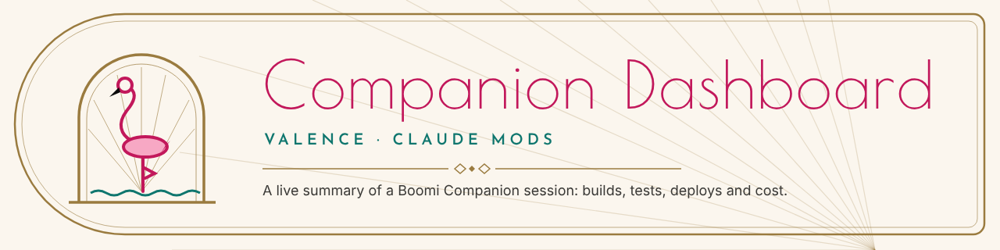
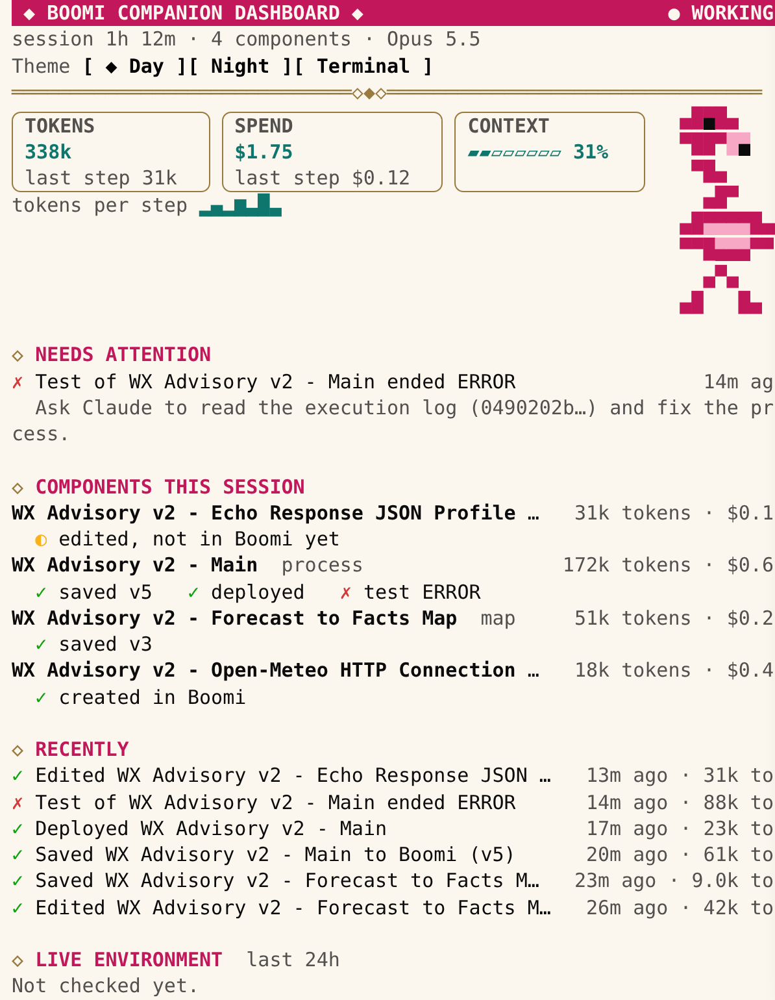
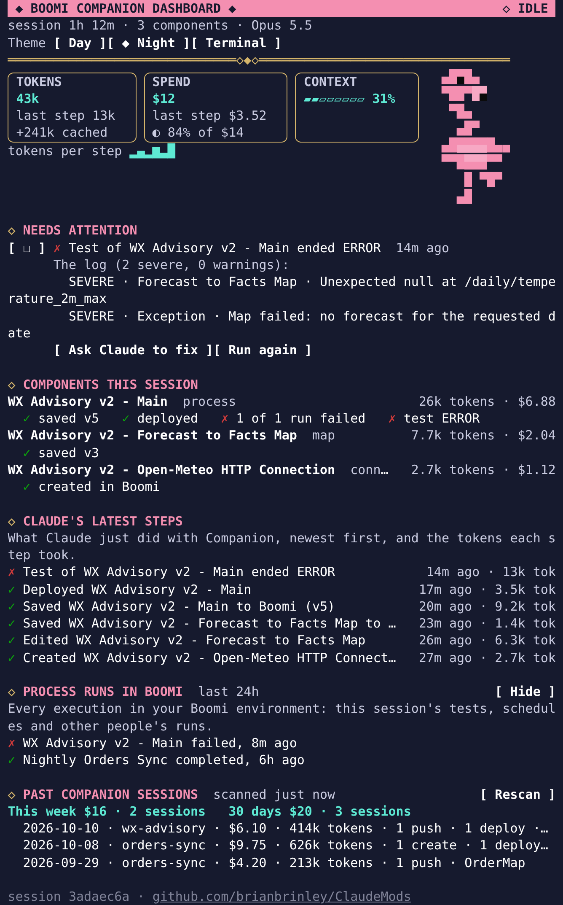
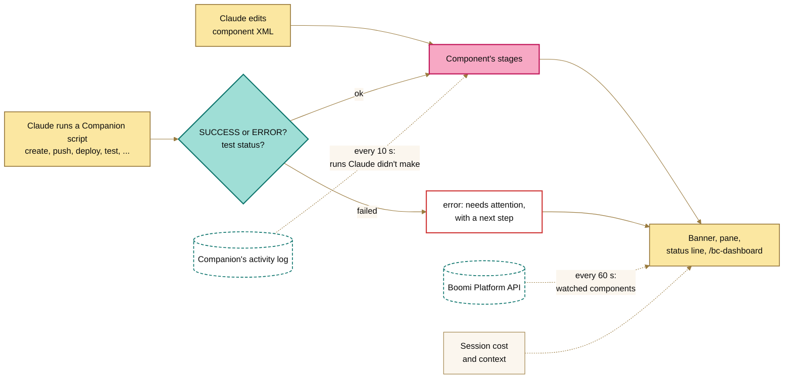

<picture>
  <source media="(prefers-color-scheme: dark)" srcset="assets/banner-night.png">
  
</picture>

# Boomi Companion Dashboard Mod

<div data-flamingo></div>

**See your whole Boomi build at a glance, right beside the conversation.** While Claude builds with [Boomi Companion](https://github.com/OfficialBoomi/bc-integration), the dashboard follows every edit, save, deploy and test. It tells you what broke and what to do next, and keeps a running total of what the session costs. You don't leave Claude Code, and you don't scroll back through the transcript.

- **Know where every component stands.** Edited, saved with its version, deployed, tested: each component's stage updates as Claude works.
- **Go from failure to fix in two clicks.** **Why?** reads a failed test's process log. **Ask Claude to fix** drafts the request with the log's lines in it, and **Run again** checks the fix without a turn of Claude's.
- **Keep spend in sight.** Tokens, cost and how full the context is, per step and per component. On a Claude seat, your 5-hour and weekly usage limits and where your pace leads, read automatically, and an optional Companion budget of your own: a share of your limit per day, week or month, or a monthly amount.
- **Learn from what cost the most.** Review a past session to see what drove its cost (the model, a long conversation, repeated tests) and the Claude Code habit that would have saved it.
- **Pick up where you left off.** A new session opens with what the last one did and left to fix, and **Past Companion sessions** shows what earlier work cost.
- **Every Companion plugin, not only integration.** Data Hub deploys, BDI flow runs, Agentstudio agents, custom connector releases and Marketplace recipes show up as steps too, with their failures under **Needs attention** and each product's share of the spend.
- **Catch what happens outside the chat.** Companion's activity log adds script runs from a terminal, and watched components flag changes someone else makes in Boomi.
- **Hand it off.** `/bc-dashboard report` writes the session up as Markdown for a pull request, a ticket or the next person.

## Install

Copy this prompt into a Claude Code session started from your Boomi Companion workspace (the folder with Companion's `.env`). It works for any Claude account. On Windows, run Claude Code in WSL and paste it there.

```prompt
Install the boomi-dashboard Claude Code mod from https://github.com/brianbrinley/ClaudeMods for my user account, so it loads in every Claude Code session on this computer.

1. Clone the repo (main branch) to ~/ClaudeMods. If it's already there, run `git -C ~/ClaudeMods pull` instead.
2. Check that ~/ClaudeMods/boomi-dashboard/.claude-plugin/plugin.json and ~/ClaudeMods/boomi-dashboard/hooks/register.tsx exist, then run `claude plugin validate ~/ClaudeMods/boomi-dashboard` and `claude plugin test ~/ClaudeMods/boomi-dashboard` and show me the results.
3. Add the mod to the "env" block of my user settings file, ~/.claude/settings.json (not the project's settings):
   "CLAUDE_CODE_PLUGIN_DIRS": "<absolute path to ~/ClaudeMods/boomi-dashboard>"
   Use the absolute path, with my home folder spelled out. If CLAUDE_CODE_PLUGIN_DIRS already has a value, append to it with ":" instead of replacing it. Keep everything else in the file as it is, and show me the diff before you save.
4. Check that Boomi Companion (bc-integration) is installed. If it isn't, tell me how to install it, but don't install it yourself.
5. Run `perl -MJSON::PP -e 'print "ok\n"'`. If it doesn't print ok, tell me the command to install Perl for this system (on Debian or Ubuntu, including WSL: `sudo apt install perl`), but don't run it yourself.
6. Tell me to restart Claude Code. After the restart I'll run /bc-dashboard to check it loaded.

Never read, print or copy my .env or any Boomi credentials. The mod reads them itself.
```

**After the restart:** `/bc-dashboard` should open the pane with nothing needing attention. Perl is only for **Past Companion sessions**; macOS and Linux have it.

**Optional:** add `BOOMI_COMPANION_LOG_ACTIVITY=1` to Companion's `.env` so its scripts keep an activity log, which the dashboard reads as a [second source](#companions-activity-log).

### How it's installed, and how to update it

The install above uses no marketplace and copies nothing. Claude Code loads the mod straight from the folder named in `CLAUDE_CODE_PLUGIN_DIRS`, a git checkout of this repository (`~/ClaudeMods`). The checkout *is* the install: whatever it holds when a session starts is what runs. Other mods from the same checkout (boomi-runtime, say) update along with it.

**To update:** run `/bc-dashboard upgrade`. It does what you'd otherwise do by hand (fetch, pull, validate, test), in this order:

1. **Check.** It runs `git fetch origin` against the checkout's own `origin` remote, which is its only network call. It shows the version change, the commits, the changed files, the [changelog](CHANGELOG.md) entries in between, and which mods from the checkout it would update.
2. **Ask.** It asks before installing. `--yes` skips only this question.
3. **Refuse rather than risk your work.** It stops, changing nothing, if the checkout has uncommitted changes or commits that aren't on origin, or if the update isn't a fast-forward. It never resets, stashes, rebases or forces.
4. **Test before it goes live.** It checks out the new code in a temporary git worktree and runs `claude plugin validate` and `claude plugin test` there, for each mod it would update. If any fail, nothing is installed and you see the failing output. From the new code it runs nothing else.
5. **Install.** It records the current commit, then fast-forwards the checkout and reads the version back.
6. **Restart Claude Code.** The running session keeps the code it started with; the dashboard can't safely reload itself.

| Command | What it does |
|---|---|
| `/bc-dashboard upgrade --check` | A dry run: the check alone. Changes nothing |
| `/bc-dashboard upgrade` | Check, ask, test, install |
| `/bc-dashboard upgrade --yes` | The same without the question. The safety steps still run |
| `/bc-dashboard upgrade --rollback` | Back to the commit recorded before the last upgrade, as a detached checkout. `main` keeps the newer commits, and the next upgrade returns to it |

Anything it prints is masked for tokens and keys (`glc_`, `sk-`, `eyJ`, `Bearer …`, `Basic …`), and it never reads `.env`.

**Update nudge:** at the start of a session, at most once every `updateCheckHours` (24), the dashboard fetches and toasts `bc-dashboard X.Y.Z is available` when you're behind. It never installs, and says nothing when offline. Turn it off with `updateCheck` under `/config`.

By hand, the same thing is `git -C ~/ClaudeMods pull --ff-only`, then `claude plugin validate` and `claude plugin test` on the mod, then a restart.

## What you see

`/bc-dashboard` opens the pane; Esc closes it. Where no pane can be shown, including Claude Code on the web, it prints the same thing as text.

**Its size:** drag the pane's edge, and Claude Code keeps the size you choose. To set it from the start, use `/bc-dashboard size <rows> [columns]` (kept for later sessions; `size` alone goes back to the default), or the `paneRows` and `paneColumns` settings. Rows are its height above the prompt, and columns its width when docked beside a fullscreen transcript.

 

- **Gauges:** tokens, spend and how full the context is, with the last step's share.
- **Needs attention:** what's still broken, each with a next step.
- **Components this session:** each component's stages, tokens and cost.
- **Claude's latest steps:** what Claude just did with Companion. **More** shows older steps.
- **Guardrails:** with [boomi-runtime](../boomi-runtime/README.md) loaded, the runtime's state and smoke test.
- **Past Companion sessions:** what earlier sessions on this machine did and cost. **More** pages through them.
- **Watched components:** components you asked to watch, and who last changed them in Boomi.
- **Themes:** **Day**, **Night** or **Terminal** (your terminal's colors), from the buttons or `/bc-dashboard theme night`. The choice is kept.

A banner above the prompt shows the latest step and what needs attention, and the status line and toasts carry the same news. In a new session, before Companion does anything, the status line says so (`New session · last one 14h ago, nothing left to fix · $0.00 this session`) rather than repeating the last session's step:

```text
◆ BC Dashboard ✓ Saved Orders Sync to Boomi (v4) 2m ago │ ✗ 1 needs attention │ 3 components │ 338k tokens · $0.54   [ Open ]  [ Hide ]
```

**A new session** in a Companion workspace opens with what the last session in that folder did, then turns through tips every 20 seconds until Companion does something:

```text
◆ BC Dashboard ✓ Last session 14h ago: 4 components · 6 saves · 2 deploys · 3 tests (1 failed) · nothing left to fix · $3.10 │ $0.00 this session   [ Open ]  [ Hide ]
◆ BC Dashboard Tip: Why? on a failed test reads its log; Ask Claude to fix drafts the request │ $0.00 this session   [ Open ]  [ Hide ]
```

Anything left to fix from the last session stays under **Needs attention**, and the banner counts it. Outside a Companion workspace (no component folder, activity log or earlier session there), the banner stays hidden.

## Stages and what needs attention

| Stage | Means |
|---|---|
| ◐ edited, not in Boomi yet | Claude changed the XML; Companion hasn't created it in Boomi. |
| ◐ edited since last save | Claude changed the XML after Companion last pushed it. |
| ✓ saved v4 | Companion pushed it; Boomi has version 4. |
| ✓ deployed / ◐ redeploy needed | Deployed, or saved again since, so the environment runs an older version. |
| ✓ test passed / ✗ test ERROR | The latest test execution's result. |
| ⚠ save blocked | Another mod refused the push. |
| ✗ save failed, ✗ deploy failed | Companion's script reported an error. |

Icons always come with a label: ✓ done, ◐ in progress or still to do, ⚠ blocked or unreachable, ✗ failed. A later success clears an earlier failure.

Each item under **Needs attention** has buttons:

- **☐** closes it, for a failure you expected or handled another way. Closed items stay closed across restarts; **Reopen** brings them back.
- **Why?** (failed tests) runs Companion's `boomi-execution-query.sh --logs` and shows the log's `SEVERE` lines. **Ask Claude to fix** then puts a fix request with those lines in the prompt box, after anything you've typed. Nothing is sent until you press Enter.
- **Run again** (failed tests Claude ran) repeats the same `boomi-test-execute.sh` call, without a turn of Claude's. A pass clears the failure.

Without a pane: `/bc-dashboard close <n>`, `why` and `rerun`. With nothing that fits, `why` and `rerun` say so; with one failure, they act on it; with several, they ask which in Claude Code's question dialog (the four newest, and **Other** takes a number). A number from `/bc-dashboard text` skips the question.

When Claude finishes a turn with a process saved but not deployed, or deployed but not tested, the prompt box suggests the next step ("Deploy Orders Sync and test it"). Tab takes it.

## Companion's other plugins

Boomi Companion is [six plugins](https://github.com/OfficialBoomi/boomi-companion). Besides bc-integration's components, the dashboard follows the other five through their scripts, the same way:

| Plugin | Steps it shows |
|---|---|
| bc-marketplace | Recipes installed (`Marketplace: installed recipe Salesforce to NetSuite Orders · 4 components`) and their supporting materials downloaded. The components a recipe copied join **Components this session**, starting `✓ from recipe …`; pull one and its name and later stages fill in the same row |
| bc-datahub | Models created, updated, published and given quality steps; sources and their initial loads; universes deployed; quarantined records approved or rejected; golden records updated, end-dated or restored. A deploy shows `◐ deploying` until its response or Claude's `datahub-deployment.sh status` says how it went, and a failed one needs attention. When Claude lists a universe's quarantine (`datahub-quarantine.sh query --universe <id>`), a **Data Hub** section keeps the count and causes, records in it need attention, and an empty list clears it |
| bc-bdi | Flows run, cancelled, activated, created or restored; CDC turned on or off; connections, environments, variables and dataframes changed. A run shows `◐ run started` until Claude checks it with `bdi-flow.sh status`, then how it ended: ✓ succeeded, cancelled, or ✗ failed with BDI's reason under **Needs attention** |
| bc-agentstudio | Agents, tools and MCP servers created or updated; agents packaged and deployed; test conversations with a deployed agent. An **Agentstudio agents** section shows each agent's stages, as components have: `✓ created  ✓ packaged v2  ✓ deployed  ✓ 2 test conversations, 5 turns, all answered`. An edit after packaging shows `◐ changed since packaged` until a new package is deployed. A conversation joins its agent through the deployment it talked to; a turn that fails (an HTTP error, a stream's `event: error`, or a reply that says `success: false`) needs attention |
| bc-connectordev | Connector projects created and checked; descriptors linted and validated; versions uploaded; groups and version changes. A **Custom connectors** section follows each connector's release, by its project folder and group: `✓ descriptor linted  ✓ validated  ✓ uploaded v2  ✓ v2 active on dev`. An upload shows `◐ v2 not active yet` until a version change makes it active, and a PUBLIC connector's change shows `◐ awaiting approval`. A lint that fails names the line and element; a descriptor validated with warnings, or rejected, needs attention |

- A step that only reads (`list`, `get`, `query`, `status`, `logs` and the like) isn't shown, as bc-integration's searches aren't.
- A failed step (an `ERROR:` line, or the script exiting with an error) goes under **Needs attention** with its error line, until the same action succeeds. A step that finished with a `WARNING:` line, such as a connector descriptor accepted with warnings, shows as ◐ and needs attention too.
- When a session works with more than one product, the pane, `/bc-dashboard text` and the report split the spend: `By product: Integration $1.20 · Data Hub $0.40`. The report lists the other plugins' steps in a section of their own.
- **Past Companion sessions** count sessions that used any of the plugins, and say what each did with them (`2 Data Hub steps · 1 BDI step`).

The wording comes from the plugins' scripts as of October 2026 (bc-marketplace 0.2.10, bc-datahub 0.2.12, bc-bdi 0.2.5, bc-agentstudio 0.1.42, bc-connectordev 0.0.50). The tests use those scripts' own `SUCCESS:`, `ERROR:` and `WARNING:` lines. Each plugin's live output still needs checking in a real session; see [CHECKLIST](../CHECKLIST.md).

## Tokens and spend

The headline counts **new tokens**: input, output and cache writes. **Cache reads**, the conversation re-read on every call, are shown apart (`+3.3M cached`): they're billed at a fraction of the price, and counted in, they'd dwarf the work done. `/bc-dashboard text` splits the session by kind, and by model when there was more than one:

```text
Tokens: 412k new (18k in · 44k out · 350k cache writes) · 3.30M cache reads
```

Spend is the session's cost as `/cost` reports it. On a Claude seat, that's what the same use would cost on the API, not a bill. A step's share is what Claude spent since the previous step; a component's is all its steps.

**Budget:** set `budgetUsd` and the status line, summary and SPEND gauge warn from 80% (`◐ 84% of the $5.00 budget`) and once it's spent, with one toast at each mark. Nothing is stopped.

### Your Claude usage limits

On a Claude seat (Pro, Max, Team or Enterprise), the dashboard reads your usage limits as Claude Code reports them, with no setup. Those are the 5-hour and weekly windows, and an admin's spend limit when one is set.

- **LIMITS** in the pane shows the busiest window, when it resets, and where your pace leads: `◐ used up in 1d 6h` when you'd run out before it resets, else `on pace for 64% by reset`.
- The banner shows them in a few characters (`week 42% · 5h 12%`). The status line, `/bc-dashboard text` and the report say more.
- A toast at 80% of a window, and one when it's used up, once per window.

On an API key there are no limits to read, so none of this shows.

### Your own Companion budget

Two optional settings under `/config` give Companion work a budget of its own. Both warn in the status line from 80%, toast at 80% and 100%, and stop nothing.

**BUDGET** in the pane shows every budget you set, `budgetUsd` included: the fullest one's meter, then a line each, such as `✓ month: $32.10 of $50`, `◐ share, today: 84% of 30%` or `✓ session: $1.25 of $5.00`. Without a budget set, it doesn't show.

- **Relative, `companionShare`:** a percent of your weekly limit that Companion may use, over `companionSharePeriod`: `week` (the last 7 days), `day` (today, a seventh of the share) or `month` (this month, the month's days in sevenths). With 30% per day, Companion gets 4.3% of your weekly limit each day: `Companion today: 2.1% of your weekly limit, 49% of its 4.3%`. From a session's first Companion step, the dashboard counts how far the weekly limit rises, by day, and adds up Companion sessions on this machine.
- **Explicit, `companionMonthlyUsd`:** an amount for this calendar month's Companion sessions, counted in Claude Code's own cost figures: the earlier sessions from **Past Companion sessions** (scanned for you, about once an hour), plus this one live.

The limit is shared, so in a Companion session anything else that uses Claude at the same time, on this machine or another, counts too. Sessions on other machines, and Claude Code on the web, aren't added up.

### Set up a budget

There are three budgets. Set any of them, or none. They only warn: nothing is ever stopped.

| You want to cap | Setting | Works on | Example |
|---|---|---|---|
| This one session's cost | `budgetUsd` | a seat or an API key | `5` warns at $4.00 and $5.00 |
| Companion's share of your weekly Claude limit | `companionShare` and `companionSharePeriod` | a Claude seat only | `30` and `day`: about 4.3% of the weekly limit each day |
| Companion's cost this calendar month, all sessions on this computer | `companionMonthlyUsd` | a seat or an API key | `50` warns at $40 and $50 |

Not sure? On a Pro or Max seat, start with `companionShare` (your limit is what runs out). On an API key, start with `companionMonthlyUsd` (your bill is what grows).

**In Claude Code (easiest):**

1. Run `/config`.
2. Find the **boomi-dashboard** rows: **Spend budget (USD)**, **Companion's share of your usage limit (%)**, **Companion share period** and **Companion's monthly amount (USD)**.
3. Type a number (no `$` or `%`), or pick the period. `0` turns a budget off.
4. The dashboard reloads with the new values. If the pane doesn't show **BUDGET** within a minute, restart Claude Code.

**In the settings file:** the same values live in your user settings, `~/.claude/settings.json`, under `pluginConfigs`. Add or edit only this block, and keep the rest of the file as it is:

```json
{
  "pluginConfigs": {
    "boomi-dashboard": {
      "options": {
        "budgetUsd": 5,
        "companionShare": 30,
        "companionSharePeriod": "day",
        "companionMonthlyUsd": 50
      }
    }
  }
}
```

Numbers go in without quotes. The period is `"day"`, `"week"` or `"month"`. Leave out a budget you don't want, or set it to `0`. Then restart Claude Code.

**Check that it took:**

- The pane shows a **BUDGET** gauge with a line for each budget you set, such as `✓ session: $1.25 of $5.00` or `◐ share, today: 84% of 30%`.
- `/bc-dashboard text` prints the same lines.
- No **BUDGET** gauge means no budget is set, or the value isn't a number. Open `/config` again and check.

**When it warns:** at 80%, the status line shows `◐` and the percent, and one toast appears. At 100% you get `✗` and a second toast. Each toast shows once, not on every refresh. To keep working past a budget, raise it or set it to `0`.

## Watched components

`/bc-dashboard watch <component ID or XML file>` watches a component across sessions. Every 60 seconds the dashboard reads (never writes) its version in Boomi; when someone other than Companion's API user changes it, it shows under **Needs attention**: pull before you push. `/bc-dashboard seen` clears the changes you expected. With nothing watched, the dashboard makes no Platform API calls.

Credentials come from Companion's `.env`, falling back to environment variables: `BOOMI_API_URL`, `BOOMI_USERNAME`, `BOOMI_API_TOKEN`, `BOOMI_ACCOUNT_ID`. The token goes only into requests' `Authorization` header; the dashboard never stores, shows or logs it, and its errors carry only the HTTP status. Without credentials, everything else still works.

Up to 0.10.0 the dashboard also polled the environment's process runs. That's set aside for now and will come back; see [IDEAS](../IDEAS.md#dashboard-follow-ups).

## Companion's activity log

With `BOOMI_COMPANION_LOG_ACTIVITY=1` in its `.env`, Companion's scripts append each operation to `.activity-log/activity.jsonl` in the workspace, on this machine only. The dashboard reads it every 10 seconds while it changes, and adds what Claude's tool calls didn't show: a script run in a terminal, by another tool, or before the mod loaded. Those steps say **log** in the pane and "from Companion's log" in `/bc-dashboard text`.

- Creates, pushes, pulls, deploys, undeploys and tests become steps, with the same stages and **Needs attention** items as Claude's own. Searches, folder lists and the like are left out.
- A script Claude ran is in both places; its log entry matches the step Claude's tool call made, so it shows once.
- Only the last 24 hours (`recentHours`) count. A log over 3.5 MB is read from its end.
- `activityLog` under `/config` turns it off.

## Past Companion sessions

**Scan** in the pane, `/bc-dashboard history`, or the `history` tool lists the sessions on this machine from the last `historyDays` days that ran a Companion script. Each one says when it started and how long it ran, what it cost, what it was about (its title if you named it with `/rename`, else your first request), and what it did:

```text
Boomi Companion sessions on this machine, last 90 days:
  This week: 3 sessions · $18.40 · 1.2M tokens
  Last 30 days: 9 sessions · $61.75 (+1 without a recorded cost) · 4.1M tokens

  Oct 10, 14:05 · 47m · $6.10 · "Build the orders sync process and test it"
      2 pushes · 1 deploy · 2 tests · Orders Sync, Order Profile · 410k tokens
```

- The cost is Claude Code's own, as `/cost` showed it, read from the transcript. Older Claude Code versions didn't record it; those sessions show tokens only.
- A session counts only if it ran a Companion script, not if it only looked at one. The folder shows on each line only when sessions come from different folders.
- **Review one:** **Review** beside a session shows what drove its cost, read from the transcript's figures, each with a change for next time. It flags the largest model doing most of the work (`/model`), a long conversation re-read on every call (`/clear`), a context that grew large (`/compact`), a session that kept compacting, the same test or push run again and again, and subagents doing much of it. **Ask Claude to review** drafts a request for a closer look in the prompt box, naming the transcript; nothing is sent until you press Enter, and that look costs a turn. `/bc-dashboard review [n]` gives the same in text; without a number it asks which of the four costliest sessions of the last 30 days.
- **Reopen one:** **Copy** beside a session puts the command that reopens it on the clipboard, `cd <its folder> && claude --resume <session ID>`, to paste into a new terminal. `/bc-dashboard resume` does the same from the prompt: with several sessions it asks which, and `resume <n>` takes the nth newest. Where the clipboard can't be reached, the command is shown to type instead.
- Transcripts are often tens of MB, past the 4 MiB a mod can read at once, so `scripts/scan-sessions.pl` reads them a line at a time and returns only each session's totals and the commands that name a Companion script. It needs Perl, which macOS and Linux have. **On Windows, run Claude Code in WSL.**

## Session report

`/bc-dashboard report` prints the session as Markdown for a pull request, ticket or hand-off: components, deployments and tests, what needs attention, runs and spend. `report save` also writes it to `boomi-session-report-<date>.md`. Claude can ask for it with the `report` tool.

## Commands and tools

| Command | Tool | Does |
|---|---|---|
| `/bc-dashboard` | | Opens the pane (Esc closes it), or prints the dashboard where no pane fits. |
| `/bc-dashboard text` | `summary` | The dashboard as text. |
| `/bc-dashboard poll` | | Checks the watched components in Boomi now. |
| `/bc-dashboard why [n]` | | The `SEVERE` lines of a failed test's log; without a number, asks which. |
| `/bc-dashboard rerun [n]` | | Runs a failed test again; without a number, asks which. |
| `/bc-dashboard close <n\|all>` / `reopen` | | Closes items, or brings them back. |
| `/bc-dashboard earlier` | | Shows this folder's steps from before the last 24 hours too. |
| `/bc-dashboard size <rows> [columns]` | | The pane's size, kept for later sessions; `size` alone goes back to the default. |
| `/bc-dashboard seen` | | Moves watched changes out of **Needs attention**. |
| `/bc-dashboard watch <id\|file>` / `unwatch <id>` | `watch` | Watches a component, or stops. |
| `/bc-dashboard report [save]` | `report` | The session report. |
| `/bc-dashboard history` | `history` | Past Companion sessions and their cost. |
| `/bc-dashboard resume [n]` | | Copies the command that reopens a past session in a new terminal; without a number, asks which. |
| `/bc-dashboard review [n]` | | What drove a past session's cost, and what to change next time; without a number, asks which of the costliest. |
| `/bc-dashboard theme [name]` | | Picks the pane's theme, or lists them. |
| `/bc-dashboard banner` | | Shows the banner again after **Hide**. |

Claude sees the tools as `mcp__boomi-dashboard__<tool>`. Ask "what's left to fix?" and it answers from the summary.

## Setup and settings

- **Your own computer:** see [Install](#install).
- **Claude Code on the web:** add the folder to `CLAUDE_CODE_PLUGIN_DIRS`, separating mods with `:`.
- **One terminal session:** `claude --plugin-dir boomi-dashboard`.

**Watched components** need network access to `api.boomi.com`. Settings are under `/config`:

| Setting | Default | |
|---|---|---|
| `paneTheme` | `day` | The pane's colors until you pick a theme. |
| `paneRows` | `0` | The pane's height above the prompt, in rows; `0` leaves it to Claude Code. A size you drag it to wins. |
| `paneColumns` | `0` | The pane's width when docked, in columns; `0` leaves it to Claude Code. |
| `flamingo` | `true` | The 8-bit flamingo, standing on one leg in a thin line of seafoam water. Every 15 seconds or so it glances back over its shoulder or blinks; now and then it shifts to the other leg or turns around; and once in a while a neighbour peeks in to say hello. |
| `recentHours` | `24` | How far back earlier sessions' steps and Companion's activity log count. |
| `envFile` | `.env` | Companion's `.env`, relative to the working directory. |
| `componentsDir` | `active-development` | Where Companion keeps component XML. |
| `pollSeconds` | `60` | How often to check the watched components; `0` turns it off. |
| `activityLog` | `true` | Read [Companion's activity log](#companions-activity-log) as a second source. |
| `toasts` | `true` | Toasts for failures, finished deploys and tests, and watched changes. |
| `banner` | `true` | The banner above the prompt, and a new session's recap and tips. |
| `budgetUsd` | `0` | The session's spend budget in US dollars; `0` turns it off. |
| `companionShare` | `0` | Companion's share of your weekly usage limit, in percent; `0` turns it off. |
| `companionSharePeriod` | `week` | What the share runs over: `day`, `week` or `month`. |
| `companionMonthlyUsd` | `0` | A monthly amount for Companion sessions, in US dollars; `0` turns it off. |
| `updateCheck` | `true` | At the start of a session, say when a newer dashboard is on GitHub (never installs). |
| `updateCheckHours` | `24` | Hours between update checks; `0` turns them off. |
| `suggestions` | `true` | Suggest the next step after a turn. |
| `historyDays` | `90` | How far back **Past Companion sessions** reads. |

## Limits

- **The web app doesn't show banners, panes, status lines or toasts yet.** Use `/bc-dashboard` or ask Claude.
- Companion's work is seen through its plugins' scripts, run from Bash, and their `SUCCESS:`/`ERROR:`/`WARNING:` lines and exit codes. A component sent another way (`curl`, another MCP server) doesn't show up, and a change to the scripts' output could need a change here.
- Steps are saved per working folder, the last 200 whatever their age. After a restart, the last 24 hours (`recentHours`) come back; **Show N earlier** under **Components this session**, or `/bc-dashboard earlier`, shows the rest, as history: their failures don't go under **Needs attention**. Tokens and spend start over each session, counted from when the mod loads.
- Cost is the whole session's, not just Companion's share.
- Past sessions are this machine's only (not the web's), and Claude Code deletes transcripts after 30 days unless `cleanupPeriodDays` says otherwise.
- **Why?** and **Run again** need Companion's scripts, found where the last one ran or in Claude Code's plugin cache, and work where the CLI runs.
- A refusal by another mod shows as blocked only if it reaches the dashboard, which depends on hook order.

## How it works



The dashboard follows Claude's tool calls, so tracking the session costs no Platform API calls. It never stops a script. The output it reads was last checked against Companion **v1.0.83**, whose own output lines are in the tests.

| Companion script | What the dashboard records |
|---|---|
| `datahub-*.sh`, `bdi-*.sh`, `agentstudio-*.sh`, `connectordev-*.sh`, `boomi-marketplace-*.sh` | A step of that product when the subcommand changes something; failed on `ERROR:` or an error exit, ◐ on `WARNING:` |
| `boomi-component-create.sh <file>` | Created, with the new ID |
| `boomi-component-push.sh <file>` | Saved, with the new version |
| `boomi-component-pull.sh` | Pulled |
| `boomi-deploy.sh` / `boomi-undeploy.sh` | Deployed or undeployed, or the error |
| `boomi-test-execute.sh --process-id <id>` | The execution's status; `ERROR`, `ABORTED` or `DISCARDED` is a failure. With `--no-wait`, ◐ submitted |
| Any other Companion script | A line under **Claude's latest steps** |

| Engine call | Used for |
|---|---|
| `tool.call` on `Bash`, `Write`, `Edit` | Companion's script runs and component edits |
| `turn.step`, `turn.start`, `turn.complete` | Each model call's tokens, and whether Claude is working |
| `$.session.usage` | Cost, context, session length and the seat's usage limits |
| `$.http.fetch` | Read-only Platform API queries for watched components |
| `$.fs` | Component XML, Companion's `.env` and its activity log |
| `$.process.run` | **Why?**, **Run again** and the session scan |
| `$.prompt.fill`, `$.prompt.suggest` | **Ask Claude to fix** and the next-step suggestion |
| `$.ui.ask` | Which failure `why` and `rerun` act on, and which session `resume` reopens |
| `$.ui.copy` | **Copy** and `resume`: the command that reopens a past session |
| `$.state`, `$.store` | What the views draw, what's kept across sessions, and the other Boomi mods' state for **Guardrails** |
| `ui.render`, `$.ui.status`, `$.ui.toast` | The banner, pane, status line and toasts |

## What's coming next

- **Process runs in Boomi, back again:** the environment's runs of this session's components, set aside in 0.11.0.
- **A failed run's documents**, not only its log, once the [execution debugger](../IDEAS.md#execution-debugger) can read them from a local runtime.
- **[Mock endpoints](../IDEAS.md#mock-endpoints) traffic**, once that mod exists.

## Development

Built against Claude Code 2.1.296.

```bash
cd boomi-dashboard
claude plugin validate .
claude plugin test .
prove tests          # scripts/scan-sessions.pl against made-up transcripts, and scripts/upgrade.sh against a throwaway repo
```

`hooks/activity.ts` holds the plain functions (stages, attention, wording, tokens), with unit tests; `hooks/platform.ts` is the Platform API client. Everything that touches the engine is in `hooks/register.tsx`, because the engine follows `$` only within one file. `assets/pane-*.png` are the pane as the test kit draws it for a sample session.
