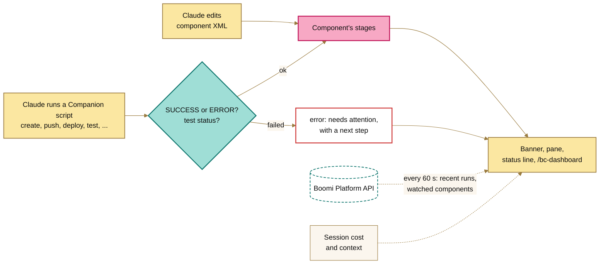

<picture>
  <source media="(prefers-color-scheme: dark)" srcset="assets/banner-night.png">
  
</picture>

# Boomi Companion Dashboard Mod

A Claude Code mod that shows where your [Boomi Companion](https://github.com/OfficialBoomi/bc-integration) build stands while Claude works: each component's stage, what failed and what to do about it, what the session has cost, and the environment's recent runs.

**Install it:** paste the prompt in [INSTALL.md](INSTALL.md) into Claude Code.

## What you see

`/bc-dashboard` opens the pane; Esc closes it. Where no pane can be shown, including Claude Code on the web, it prints the same thing as text.

 

- **Gauges:** tokens, spend and how full the context is, with the last step's share.
- **Needs attention:** what's still broken, each with a next step.
- **Components this session:** each component's stages, tokens and cost.
- **Claude's latest steps:** what Claude just did with Companion.
- **Process runs in Boomi:** every execution in the environment in the last 24 hours. **Hide** folds it to one line.
- **Guardrails:** with [boomi-standards](../boomi-standards/README.md) or [boomi-runtime](../boomi-runtime/README.md) loaded, the last standards check (what it blocked, and why) and the runtime's state and smoke test.
- **Past Companion sessions:** what earlier sessions on this machine cost.
- **Themes:** **Day**, **Night** or **Terminal** (your terminal's colors), from the buttons or `/bc-dashboard theme night`. The choice is kept.

A banner above the prompt shows the latest step and what needs attention, and the status line and toasts carry the same news:

```text
◆ BC Dashboard ✓ Saved Orders Sync to Boomi (v4) 2m ago │ ✗ 1 needs attention │ 3 components │ 338k tokens · $0.54   [ Open ]  [ Hide ]
```

## Stages and what needs attention

| Stage | Means |
|---|---|
| ◐ edited, not in Boomi yet | Claude changed the XML; Companion hasn't created it in Boomi. |
| ◐ edited since last save | Claude changed the XML after Companion last pushed it. |
| ✓ saved v4 | Companion pushed it; Boomi has version 4. |
| ✓ deployed / ◐ redeploy needed | Deployed, or saved again since, so the environment runs an older version. |
| ✓ test passed / ✗ test ERROR | The latest test execution's result. |
| ✗ 1 of 5 listener runs failed | Its runs in Boomi in the last 24 hours, matched by component ID. |
| ⚠ save blocked | Another mod, such as [boomi-standards](../boomi-standards/README.md), refused the push. |
| ✗ save failed, ✗ deploy failed | Companion's script reported an error. |

Icons always come with a label: ✓ done, ◐ in progress or still to do, ⚠ blocked or unreachable, ✗ failed. A later success clears an earlier failure.

Each item under **Needs attention** has buttons:

- **☐** closes it, for a failure you expected or handled another way. Closed items stay closed across restarts; **Reopen** brings them back.
- **Why?** (failed tests and runs) runs Companion's `boomi-execution-query.sh --logs` and shows the log's `SEVERE` lines. **Ask Claude to fix** then puts a fix request with those lines in the prompt box, after anything you've typed. Nothing is sent until you press Enter.
- **Run again** (failed tests Claude ran) repeats the same `boomi-test-execute.sh` call, without a turn of Claude's. A pass clears the failure.

Without a pane: `/bc-dashboard close <n>`, `why <n>` and `rerun <n>`, with the numbers from `/bc-dashboard text`.

When Claude finishes a turn with a process saved but not deployed, or deployed but not tested, the prompt box suggests the next step ("Deploy Orders Sync and test it"). Tab takes it.

## Tokens and spend

The headline counts **new tokens**: input, output and cache writes. **Cache reads**, the conversation re-read on every call, are shown apart (`+3.3M cached`): they're billed at a fraction of the price, and counted in, they'd dwarf the work done. `/bc-dashboard text` splits the session by kind, and by model when there was more than one:

```text
Tokens: 412k new (18k in · 44k out · 350k cache writes) · 3.30M cache reads
```

Spend is the session's cost as `/cost` reports it. A step's share is what Claude spent since the previous step; a component's is all its steps.

**Budget:** set `budgetUsd` and the status line, summary and SPEND gauge warn from 80% (`◐ 84% of the $5.00 budget`) and once it's spent, with one toast at each mark. Nothing is stopped.

## Process runs in Boomi

With Companion's credentials, the dashboard reads (never writes) the runs on the runtimes attached to `BOOMI_ENVIRONMENT_ID`: every 60 seconds, soon after a deploy or test, and every 10 seconds while a run is in progress.

- A run is matched to this session's components by process ID, so a component's row shows its runs, and a failed run names its component. `/bc-dashboard seen` moves an expected failure out of **Needs attention**.
- `/bc-dashboard watch <component ID or XML file>` watches a component across sessions. When someone other than Companion's API user changes it, it shows under **Needs attention**: pull before you push.

Credentials come from Companion's `.env`, falling back to environment variables: `BOOMI_API_URL`, `BOOMI_USERNAME`, `BOOMI_API_TOKEN`, `BOOMI_ACCOUNT_ID`, `BOOMI_ENVIRONMENT_ID`. The token goes only into requests' `Authorization` header; the dashboard never stores, shows or logs it, and its errors carry only the HTTP status. Without credentials, everything else still works.

## Past Companion sessions

**Scan** in the pane, `/bc-dashboard history`, or the `history` tool lists the sessions on this machine from the last `historyDays` days that ran a Companion script:

```text
Boomi Companion sessions on this machine, last 90 days:
  This week: 3 sessions · $18.40 · 1.2M tokens
  Last 30 days: 9 sessions · $61.75 (+1 without a recorded cost) · 4.1M tokens

  2026-10-10 · orders · $6.10 · 410k tokens · 2 pushes · 1 deploy · 2 tests · Orders Sync, Order Profile
```

- The cost is Claude Code's own, as `/cost` showed it, read from the transcript. Older Claude Code versions didn't record it; those sessions show tokens only.
- A session counts only if it ran a Companion script, not if it only looked at one.
- Transcripts are often tens of MB, past the 4 MiB a mod can read at once, so `scripts/scan-sessions.pl` reads them a line at a time and returns only each session's totals and the commands that name a Companion script. It needs Perl, which macOS and Linux have. **On Windows, run Claude Code in WSL.**

## Session report

`/bc-dashboard report` prints the session as Markdown for a pull request, ticket or hand-off: components, deployments and tests, what needs attention, runs and spend. `report save` also writes it to `boomi-session-report-<date>.md`. Claude can ask for it with the `report` tool.

## Commands and tools

| Command | Tool | Does |
|---|---|---|
| `/bc-dashboard` | | Opens the pane (Esc closes it), or prints the dashboard where no pane fits. |
| `/bc-dashboard text` | `summary` | The dashboard as text. |
| `/bc-dashboard poll` | | Checks Boomi now. |
| `/bc-dashboard why <n>` | | The `SEVERE` lines of a failed item's log. |
| `/bc-dashboard rerun <n>` | | Runs a failed test again. |
| `/bc-dashboard close <n\|all>` / `reopen` | | Closes items, or brings them back. |
| `/bc-dashboard seen` | | Moves current failed runs and watched changes out of **Needs attention**. |
| `/bc-dashboard watch <id\|file>` / `unwatch <id>` | `watch` | Watches a component, or stops. |
| `/bc-dashboard report [save]` | `report` | The session report. |
| `/bc-dashboard history` | `history` | Past Companion sessions and their cost. |
| `/bc-dashboard theme [name]` | | Picks the pane's theme, or lists them. |
| `/bc-dashboard banner` | | Shows the banner again after **Hide**. |

Claude sees the tools as `mcp__boomi-dashboard__<tool>`. Ask "what's left to fix?" and it answers from the summary.

## Setup and settings

- **Your own computer:** [INSTALL.md](INSTALL.md).
- **Claude Code on the web:** add the folder to `CLAUDE_CODE_PLUGIN_DIRS`, separating mods with `:`.
- **One terminal session:** `claude --plugin-dir boomi-dashboard`.

**Process runs in Boomi** needs network access to `api.boomi.com`. Settings are under `/config`:

| Setting | Default | |
|---|---|---|
| `paneTheme` | `day` | The pane's colors until you pick a theme. |
| `flamingo` | `true` | The 8-bit flamingo: it paces while Claude works and stands on one leg while idle. |
| `recentHours` | `24` | How far back **Process runs in Boomi** goes. |
| `envFile` | `.env` | Companion's `.env`, relative to the working directory. |
| `componentsDir` | `active-development` | Where Companion keeps component XML. |
| `pollSeconds` | `60` | How often to check Boomi; `0` turns it off. |
| `toasts` | `true` | Toasts for failures, finished deploys and tests, and watched changes. |
| `banner` | `true` | The banner above the prompt. |
| `budgetUsd` | `0` | The session's spend budget in US dollars; `0` turns it off. |
| `suggestions` | `true` | Suggest the next step after a turn. |
| `historyDays` | `90` | How far back **Past Companion sessions** reads. |

## Limits

- **The web app doesn't show banners, panes, status lines or toasts yet.** Use `/bc-dashboard` or ask Claude.
- Companion's work is seen through its scripts, run from Bash, and their `SUCCESS:`/`ERROR:` lines. A component sent another way (`curl`, another MCP server) doesn't show up, and a change to the scripts' output could need a change here.
- Steps are saved per working folder; after a restart, the last 24 hours come back marked as earlier. Tokens and spend start over each session, counted from when the mod loads.
- Cost is the whole session's, not just Companion's share.
- Past sessions are this machine's only (not the web's), and Claude Code deletes transcripts after 30 days unless `cleanupPeriodDays` says otherwise.
- **Why?** and **Run again** need Companion's scripts, found where the last one ran or in Claude Code's plugin cache, and work where the CLI runs.
- A refusal by another mod shows as blocked only if it reaches the dashboard, which depends on hook order.

## How it works



The dashboard follows Claude's tool calls, so tracking the session costs no Platform API calls. It never stops a script. The output it reads was last checked against Companion **v1.0.83**, whose own output lines are in the tests.

| Companion script | What the dashboard records |
|---|---|
| `boomi-component-create.sh <file>` | Created, with the new ID |
| `boomi-component-push.sh <file>` | Saved, with the new version |
| `boomi-component-pull.sh` | Pulled |
| `boomi-deploy.sh` / `boomi-undeploy.sh` | Deployed or undeployed, or the error |
| `boomi-test-execute.sh --process-id <id>` | The execution's status; `ERROR`, `ABORTED` or `DISCARDED` is a failure. With `--no-wait`, ◐ submitted |
| Any other Companion script | A line under **Claude's latest steps** |

| Engine call | Used for |
|---|---|
| `tool.call` on `Bash`, `Write`, `Edit` | Companion's script runs and component edits |
| `turn.step`, `turn.start`, `turn.complete` | Each model call's tokens, and whether Claude is working |
| `$.session.usage` | Cost, context and session length |
| `$.http.fetch` | Read-only Platform API queries |
| `$.process.run` | **Why?**, **Run again** and the session scan |
| `$.prompt.fill`, `$.prompt.suggest` | **Ask Claude to fix** and the next-step suggestion |
| `$.state`, `$.store` | What the views draw, what's kept across sessions, and the other Boomi mods' state for **Guardrails** |
| `ui.render`, `$.ui.status`, `$.ui.toast` | The banner, pane, status line and toasts |

## To do

- [ ] Run it against a live Boomi account and Companion session.
- [ ] Show a failed run's documents, not only its log, once the [execution debugger](../IDEAS.md#execution-debugger) can read them from a local runtime.
- [ ] Show [mock endpoints](../IDEAS.md#mock-endpoints) traffic once that mod exists.
- [ ] Read Companion's activity log (`.activity-log/activity.jsonl`) as a second source.

## Development

Built against Claude Code 2.1.296.

```bash
cd boomi-dashboard
claude plugin validate .
claude plugin test .
prove tests          # scripts/scan-sessions.pl against made-up transcripts
```

`hooks/activity.ts` holds the plain functions (stages, attention, wording, tokens), with unit tests; `hooks/platform.ts` is the Platform API client. Everything that touches the engine is in `hooks/register.tsx`, because the engine follows `$` only within one file. `assets/pane-*.png` are the pane as the test kit draws it for a sample session.
