<picture>
  <source media="(prefers-color-scheme: dark)" srcset="assets/banner-night.png">
  
</picture>

# Boomi Runtime Mod

A Claude Code mod that gives a session its own temporary Boomi runtime. It provisions the runtime, points [Boomi Companion](https://github.com/OfficialBoomi/bc-integration) at it so Companion can build and test on it, and deletes it when you're done. No admin rights or Windows/Linux service needed.

> **Prototype.** Linux only, built for Claude Code on the web. Verified end to end against a live Boomi account: provision, attach, smoke test and teardown.

## What it does

```mermaid
%%{init: {"theme": "base", "fontFamily": "Josefin Sans, trebuchet ms, verdana, arial, sans-serif", "themeVariables": {"fontSize": "15px", "background": "#FBF6EE", "primaryColor": "#FBF6EE", "primaryTextColor": "#0B0B0B", "primaryBorderColor": "#9A7B3F", "lineColor": "#9A7B3F", "textColor": "#0B0B0B", "secondaryColor": "#9FDED6", "tertiaryColor": "#FBE7A1", "edgeLabelBackground": "#FBF6EE", "clusterBkg": "#FBF6EE", "clusterBorder": "#9A7B3F", "actorBkg": "#F7A8C4", "actorBorder": "#C2185B", "actorTextColor": "#0B0B0B", "actorLineColor": "#9A7B3F", "signalColor": "#0B0B0B", "signalTextColor": "#0B0B0B", "labelBoxBkgColor": "#FBE7A1", "labelBoxBorderColor": "#9A7B3F", "labelTextColor": "#0B0B0B", "loopTextColor": "#0B0B0B", "noteBkgColor": "#FBE7A1", "noteBorderColor": "#9A7B3F", "noteTextColor": "#0B0B0B", "activationBkgColor": "#9FDED6", "activationBorderColor": "#0F766E", "sequenceNumberColor": "#FBF6EE"}}}%%
flowchart LR
    A["/boomi up"] --> B["Installer token<br/>and a TEST environment"]
    B --> C["Quiet Linux install<br/>and start"]
    C --> D{"Online within<br/>10 minutes?"}
    D -- yes --> E["Attach to environment<br/>write Companion's .env"]
    D -- no --> X["error: phase error,<br/>see /boomi logs"]
    E --> F["/boomi smoke<br/>hello world: deploy, run, wait"]
    E --> G["Boomi Companion<br/>builds and tests components"]
    F --> H["/boomi down<br/>or session end"]
    G --> H
    H --> I["Undeploy, delete runtime,<br/>environment and files"]
    P[("Boomi Platform API")]
    B -.-> P
    I -.-> P
    class C,E focus
    class D decision
    class A,F,H highlight
    class P,G external
    class X error
    classDef focus fill:#F7A8C4,stroke:#C2185B,stroke-width:2px,color:#0B0B0B
    classDef decision fill:#9FDED6,stroke:#0F766E,stroke-width:2px,color:#0B0B0B
    classDef highlight fill:#FBE7A1,stroke:#9A7B3F,stroke-width:1.5px,color:#0B0B0B
    classDef external fill:#FFFFFF,stroke:#0F766E,stroke-width:1.5px,stroke-dasharray:5 3,color:#0B0B0B
    classDef error fill:#FFFFFF,stroke:#D03B3B,stroke-width:2px,color:#0B0B0B
```



1. Creates an installer token and a **TEST** environment named after the runtime (or falls back to `BOOMI_ENVIRONMENT_ID` if your account can't create environments).
2. Downloads the Linux installer and installs the runtime quietly under `~/.boomi-runtimes/<name>`.
3. Waits until it's `ONLINE`, attaches it, and writes `BOOMI_TEST_ATOM_ID` and `BOOMI_ENVIRONMENT_ID` into Companion's `.env`, keeping the old values for teardown.
4. **`/boomi smoke`** deploys and runs a hello-world process and waits for `COMPLETE`. The Platform API can't delete components, so one `boomi-runtime hello world` process in `BOOMI_TARGET_FOLDER` is reused.
5. **`/boomi down`**, or the end of the session, undeploys, stops and deletes the runtime and its environment, restores `.env` and removes the files.

Runtimes are named `<prefix>-<date>-<session>`, such as `cc-20261002-dwmarays`. If a container is reclaimed before teardown, `/boomi reap` deletes offline runtimes with your prefix.

## Commands and tools

| Command | Tool | Does |
|---|---|---|
| `/boomi up` | `up` | Provisions a runtime. Returns at once; the pane shows progress. |
| `/boomi smoke` | `smoke` | Runs the hello-world smoke test. |
| `/boomi status` | `status` | Phase, runtime, environment, smoke test and recent executions. |
| `/boomi logs [n]` | `logs` | The last *n* lines of the runtime's newest log. |
| `/boomi down` | `down` | Tears everything down. |
| `/boomi reap` | | Deletes offline runtimes left by earlier sessions. |
| `/boomi doctor` | `doctor` | Checks the host, credentials, where the token comes from, and the network. |
| `/boomi env` | | Companion's `.env`, token masked. |
| `/boomi set KEY=VALUE` | | Sets one non-secret value in `.env`, such as `BOOMI_TARGET_FOLDER`. |

Claude sees the tools as `mcp__boomi-runtime__<tool>`. A status line shows the runtime's state with an icon and a label (✓ online, ◐ installing, ⚠ offline, ✗ error).

## Setup on Claude Code on the web

In the cloud environment's settings (environment menu in the session's title bar → **Edit**):

1. **Network access:** allow `*.boomi.com`, plus any systems your integration calls.
2. **Environment variables:**
   - `CLAUDE_CODE_PLUGIN_DIRS=/home/user/ClaudeMods/boomi-runtime` loads the mod.
   - `BOOMI_API_URL` (such as `https://api.boomi.com`), `BOOMI_USERNAME`, `BOOMI_API_TOKEN` and `BOOMI_ACCOUNT_ID`, unless the session already has Companion's `.env`. Optional: `BOOMI_ENVIRONMENT_ID`, `BOOMI_TARGET_FOLDER` (an ID, name or path; the mod writes the ID) and `BOOMI_RUNTIME_ROOT`.
3. **Setup script**, to install Companion in every session (the repository's `.claude/settings.json` declares it, but that alone doesn't install it):
   ```bash
   claude plugin marketplace add OfficialBoomi/boomi-companion
   claude plugin install bc-integration@boomi-companion
   ```
4. Start a session and run `/boomi doctor`.

`/boomi up` writes Companion's `.env` from those variables if there isn't one; values already in `.env` win. Then ask Claude to build something ("a process that reads this CSV and posts each row to this API, then deploy and test it"), and Companion deploys and tests on this session's runtime.

The API user needs to create installer tokens and environments, attach runtimes, deploy, execute, and delete runtimes and environments. On your own machine, load the mod with `claude --plugin-dir boomi-runtime`.

## Settings

Under `/config`:

| Setting | Default | |
|---|---|---|
| `namePrefix` | `cc` | Start of every runtime name; `/boomi reap` matches on it. |
| `installRoot` | `$BOOMI_RUNTIME_ROOT`, else `~/.boomi-runtimes` | Where runtimes are installed. |
| `envFile` | `.env` | Companion's `.env`, relative to the session's folder. |
| `installerUrl` | `https://platform.boomi.com/atom/atom_install64.sh` | The Linux installer. |
| `installerArgs` | | Extra quiet-install arguments, such as proxy settings. |
| `ephemeral` | `true` | Tear down when the session ends. |
| `guard` | `true` | The token guard below. |
| `apiToken` | | The API token in secure storage. Set it from a terminal, not `/config`: see [Secure the API token](#secure-the-api-token). |

## Protecting the API token

- **A guard on tool calls** refuses calls that would show the token: reading or searching `.env`, printing the environment (`env`, `printenv`, `set`, `export -p`, `/proc/*/environ`), or naming `BOOMI_API_TOKEN`. `.env.example` stays readable, and Companion's scripts run as usual.
- **Redaction:** output that contains the token, or the Basic auth value built from it, is withheld, and everything the mod shows has it replaced with `‹redacted›`.

Use `/boomi env` and `/boomi set` to see and change `.env` without exposing the token. The guard protects the conversation, not the machine: a process in the container can still read the environment.

### Secure the API token

A token in `.env` or an environment variable sits in plain text all session. Keep it in Claude Code's secure storage instead, and the mod hands it to Companion only while one of Companion's scripts runs.

This works because Companion's scripts (`boomi-common.sh` in [OfficialBoomi/bc-integration](https://github.com/OfficialBoomi/bc-integration)) `source ./.env` and then require the token: one `.env` doesn't set is taken from the environment the script started in. So for a Bash command that runs a Companion script, the mod puts the token in the environment, and takes it out when the command ends.

1. **Use a dedicated API user** with a role that has API access and only what the work needs: building and deploying components, executing processes, and for this mod, managing runtimes and environments. Privilege names vary by account (**Settings → User Management → Roles**). Generate its token under **Settings → Account Information and Setup → AtomSphere API Tokens**.
2. **Save the token from a terminal**, never in the chat, for each mod by the ID `claude plugin list` shows (`<name>@inline` for a mod loaded from a folder):
   ```bash
   read -rs -p 'Boomi API token: ' T; echo
   for mod in boomi-runtime@inline boomi-dashboard@inline; do
     printf '{"apiToken":"%s"}' "$T" | claude plugin configure "$mod" --values-stdin
   done
   unset T
   ```
3. **Delete the `BOOMI_API_TOKEN` line from `.env`** (or comment it out), and the environment variable if you set one. Keep the file: Companion's scripts need it. A token line left in `.env`, even an empty one, overrides the secure token; the mod warns you about it.
4. Start a new session and run `/boomi doctor`: it should say *API token in Claude Code's secure storage*.

**To rotate it:** generate a new token, repeat step 2, start a new session, then revoke the old token in Boomi.

While a Companion script runs, its command has the token in its environment, as every command does today. The [dashboard](../boomi-dashboard/README.md)'s **Why?** and **Run again** pass it the same way, to that one process.

## How it works

The mod is one folder of TypeScript that Claude Code loads into the session: no server to host and no service to register. The container is the disposable machine, and the runtime is an ordinary process in it.

| Engine call | Used for |
|---|---|
| `$.command.register`, `$.tool.register` | `/boomi` and the tools Claude calls |
| `$.http.fetch` | Every Platform API call |
| `$.process.spawn`, `$.process.run` | The installer, `bin/atom`, cleanup |
| `$.fs` | Companion's `.env` and the runtime's logs |
| `$.env` | Credentials from the environment, and the token while a Companion script runs |
| `$.clock`, `$.state` | Polling, and what exists to clean up |
| `session.start`, `session.end` | Registering, and teardown |
| `$.ui.status`, `$.ui.open`, `$.ui.toast` | Status line, pane and toasts (not on the web yet: use `/boomi status`) |

Limits:

- The mod API is early access and may change.
- `session.end` doesn't run if the container is reclaimed first; `/boomi reap` cleans up.

## To do

- [ ] Try the cloud environment's network secrets (credentials added in the proxy) with Companion's scripts, which send their own `Authorization` header.
- [ ] A full credential broker: the mod makes allow-listed Platform API calls for other mods and skills ([IDEAS](../IDEAS.md#credential-broker)).
- [ ] Windows: a native runtime, with WSL2 and a container as fallbacks.

## Development

Built against Claude Code 2.1.287.

```bash
cd boomi-runtime
claude plugin validate .
claude plugin test .
```

`hooks/platform.ts`, `envfile.ts`, `linux.ts`, `smoke.ts`, `secrets.ts` and `tokens.ts` are plain functions with unit tests. Everything that touches the engine is in `hooks/register.tsx`, because the engine follows `$` only within one file.
